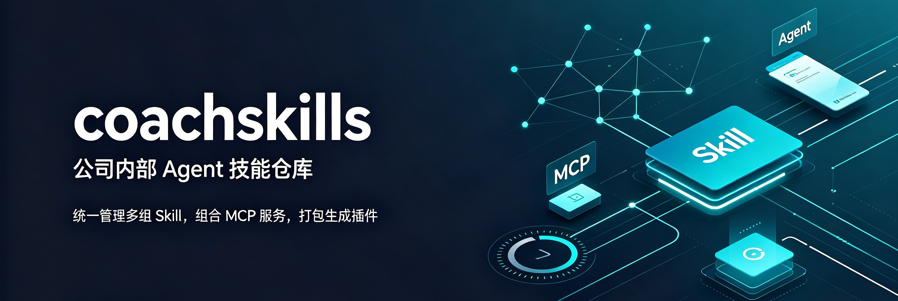

# Coach Skills



> 深维智讯 AI 教练技能仓库 — 销售陪练 · 学习闪卡 · 课程推荐 · MCP 连接诊断。让 AI 成为你的专属销售教练：你说需求，AI 教练帮你建课、出题、推荐、诊断。

深维智讯将销售培训与学习场景的最佳实践提炼为标准化的 AI 技能套件，覆盖从课程设计、资料上传、练习交付到学习闪卡生成的完整流程。每个技能遵循标准 `SKILL.md` 格式，兼容任何支持 Agent Skills 的 AI 工具；同时打包为插件，可在 Claude Code 中一键安装。

每个技能是一个独立文件夹（`SKILL.md` + 参考资料）。安装到 AI 工具后，AI 会在匹配场景自动加载对应技能——无需手动编写 prompt。

## Quick Install

```bash
npx skills add omnimay/coach_skills
```

提示时选择全部或仅需要的技能。详见 [Installation](#installation)。

## What's Inside

本仓库包含 4 个技能，覆盖销售培训与学习场景的核心能力：

| 技能 | 功能 | 适用场景 |
|------|------|---------|
| [`ai-customer-design`](skills/ai-customer-design/) | 创建/修改培训课程、上传资料、生成练习链接 | 销售陪练、课程设计、资料管理 |
| [`flashcard-design`](skills/flashcard-design/) | 对话式创建/编辑闪卡课程，支持文档出题 | 学习闪卡、知识考核、权限路由 |
| [`recommend-courses`](skills/recommend-courses/) | 处理分析报告并下发培训任务：从报告中提取学员短板，自动匹配或创建课程，批量下发任务 | 分析报告处理、短板提取、课程匹配、任务下发、培训闭环 |
| [`coach-mcp-connect`](skills/coach-mcp-connect/) | MCP 连接诊断与恢复 | 连接问题排查、配置修复 |

4 个技能，覆盖销售培训全流程。

## Installation

### Option 1: Skills CLI（推荐）

```bash
npx skills add omnimay/coach_skills
```

[skills.sh](https://skills.sh) CLI 从 GitHub 拉取仓库并安装技能到你的工具技能目录——提示时选择全部或仅需要的技能。

**前置要求**：Node.js ≥22.20.0（含 npx）

### Option 2: 手动安装

```bash
git clone https://github.com/omnimay/coach_skills.git
```

将需要的 `skills/<name>/` 文件夹复制到你的工具技能目录。安装后，每个技能通过 `SKILL.md` 的 `description` 自动注册，AI 会在匹配场景调用。

**前置要求**：Python 3.10+（脚本功能需要：`upload_document.py`、`render_qr.py`、`mcp_diagnose.py`）

## 使用场景

### 销售陪练

1. **建课**：告诉 AI 教练课程主题和目标
2. **改课**：调整课程内容、难度、题数
3. **资料上传**：上传产品文档、案例作为出题素材
4. **练习交付**：生成练习链接，学员开始训练

### 学习闪卡

1. **出题**：基于文档或知识点生成闪卡题目
2. **验题**：检查题目质量和准确性
3. **权限路由**：管理员获得编辑链接，学员自动进入练习

### 培训任务下发

1. **报告分析**：从录音分析、复盘总结、能力评估等报告中提取学员短板
2. **课程匹配**：按标签匹配现有课程，无匹配时自动委托建课
3. **任务下发**：向指定学员批量下发培训任务
4. **培训闭环**：跟踪任务完成进度

### MCP 连接诊断

1. **诊断**：AI 自动检测 MCP 连接问题
2. **恢复**：按指引修复配置，恢复连接

## MCP Enhancement（可选）

部分技能依赖外部 MCP 服务。使用前需在你的工具 MCP 连接器页面配置：

| 技能 | MCP 服务 | 用途 |
|------|---------|------|
| `ai-customer-design` | 深维智讯 MCP | 课程创建、资料上传、练习生成 |
| `flashcard-design` | 深维智讯 MCP | 闪卡课程创建、文档出题 |
| `recommend-courses` | 深维智讯 MCP | 课程匹配、标签管理、任务下发 |

未配置 MCP 时，技能会降级运行（无错误、不阻塞），但部分功能不可用。

## 首次配置

1. **安装技能**：按上方 Installation 步骤安装
2. **连接 MCP**：在工具 MCP 配置页添加深维智讯 MCP 服务
3. **用户授权**：联系管理员获取账号，配置认证信息
4. **验证连接**：告诉 AI 教练"建一个销售陪练课程"，验证功能正常

## 更新说明

技能需手动更新。按技能名更新（不支持 `owner/repo` 格式）：

```bash
# 更新本项目所有技能
npx skills update ai-customer-design flashcard-design recommend-courses coach-mcp-connect

# 或更新单个技能
npx skills update ai-customer-design
```

更新后，宿主工具（Claude Code 等）下次会话自动加载新版本。

## License & Notices

MIT — 详见 [LICENSE](LICENSE)。

**免责声明**：本仓库提供销售培训方法论参考，不构成法律建议。涉及数据采集和外联场景（客户名单构建、邮件富化、冷邮件等），用户需自行负责数据合规与个人信息保护（如 PIPL、广告法、目标平台服务条款）。提及的第三方服务（如深维智讯 MCP）需用户自行申请账号和授权，与本仓库无关。

## Feedback

欢迎提交 [Issue](https://github.com/omnimay/coach_skills/issues) 反馈问题或建议，或提交 PR 贡献技能。

---

**深维智讯** — 让 AI 成为你的销售教练
