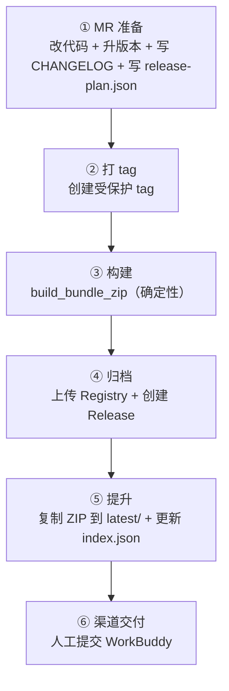

# 发布手册

> 本手册描述 RFC-0003 Bundle 化打包体系 + RFC-0006 版本与交付目录方案的发布流程。

## 核心概念

| 层 | 存什么 | 在哪里 | 谁用 |
|---|---|---|---|
| 🏷️ Git tag | 源码快照 | 本仓库 | 追溯构建来源 |
| 📦 Registry | 不可变的带版本 ZIP + SHA-256 | GitLab Generic Package Registry | 长期归档、审计 |
| 📂 latest/ | 每个坐标的最新正式 ZIP | `dist/<target>/latest/` | 日常取包 |

**坐标** = `bundle ID × 版本 × target × 变体`（WorkBuddy 的变体 = 环境：coach / test / dingtalk）

**tag 格式**：`<bundle-id>-v<SemVer>`（如 `ai-customer-v1.0.5`）

## 发布流程



### 步骤详解

| 步骤 | 做什么 | 关键约束 |
|---|---|---|
| ① MR 准备 | 改代码 + 升版本 + 写 CHANGELOG + 写 release-plan.json | `check.py` 静态检查通过；合并前不动 `latest/` |
| ② 打 tag | 创建 `<bundle-id>-v<SemVer>` 受保护 tag | tag 名称 = `bundle.json` 的 `id` + `-v` + `version`（三者必须一致，否则 CI `plan` 阶段报错） |
| ③ 构建 | 共用 `build_bundle_zip` 函数（CI 自动） | 同输入 → 同哈希 |
| ④ 归档 | 上传 Registry + 创建 Release（CI 自动） | 同坐标同哈希 = 安全重试；不同哈希 = 阻断 |
| ⑤ 提升 | 复制 ZIP 到 `latest/`，更新 `index.json`（CI 自动） | 全有或全无；碰撞检测读默认分支实际索引 |
| ⑥ 渠道交付 | 人工提交 WorkBuddy | Release 描述分两段：机器资产 + 人工渠道状态 |

## 维护命令手册

维护环境：CI linux、Python 3.11；开发依赖在 `requirements-dev.txt` 固定精确版本。

| 脚本 | 接口 | 行为 |
|---|---|---|
| 检查 | `python scripts/check.py` | 校验技能通用化基线 + bundle manifest + release-plan + distribution |
| 打包 | `python scripts/pack.py [--bundle <name>] [--target <platform>] [--env <env>] [--out <dir>]` | 从 bundles/ 配置生成平台特定 zip（开发调试用） |
| 发布 | `python scripts/release_bundle.py <plan\|archive\|promote\|full> <tag> [--dry-run]` | RFC-0006 发布入口（CI 调用） |

### check.py（仓库静态检查）

```bash
python3 scripts/check.py             # 全量
python3 scripts/check.py --only <检查项>  # 只跑所选检查
```

检查项包括：
- `frontmatter`：SKILL.md frontmatter 白名单
- `host-terms`：禁用宿主名称
- `trigger-phrases`：禁用触发词句式
- `mechanism-terms`：禁用宿主私有机制
- `references`：引用文件存在性
- `manifests`：bundle.json 完整性（通用 + WorkBuddy 平台校验）
- `qr-fallback`：二维码降级路径
- `oauth-copy`：OAuth 文案中性
- `file-boundary`：敏感文件 / 路径穿越
- `release-plan`：release-plan.json 完整性（RFC-0006）
- `distribution`：distributionName 合法性（RFC-0006）

### pack.py（打包，开发调试）

```bash
python3 scripts/pack.py                                    # 打包所有 bundle（默认 test 环境）
python3 scripts/pack.py --bundle ai-customer               # 打包指定 bundle
python3 scripts/pack.py --bundle ai-customer --target workbuddy  # 指定目标平台
python3 scripts/pack.py --env coach                        # 打包到 coach（正式）环境
python3 scripts/pack.py --out dist/workbuddy               # 指定输出目录（默认）
```

- 从 `bundles/<bundle>/` 读取 `bundle.json`
- 从 `environments.json` 加载环境 URL，替换 bundle.json 中的 `${VAR}` 占位符
- 通用校验（schema、skills 目录、icon）+ WorkBuddy 平台校验（一个 MCP server、HTTPS）
- 从 `skills/` 递归复制引用的 skill（排除 `__pycache__` 和 `.pyc`）
- 生成确定性 zip（固定时间戳/排序/权限）
- 产物落 `dist/workbuddy/`：`<bundle-id>-v<version>-<env>.zip`

### release_bundle.py（发布入口）

```bash
python3 scripts/release_bundle.py plan ai-customer-v1.0.5         # 预览发布计划（可安全运行，不执行任何修改）
python3 scripts/release_bundle.py archive ai-customer-v1.0.5      # 构建 + 上传 Registry + 创建 Release
python3 scripts/release_bundle.py promote ai-customer-v1.0.5      # 复制到 latest/ + 更新 index.json
python3 scripts/release_bundle.py full ai-customer-v1.0.5 --dry-run  # 全流程预览（不实际执行）
```

环境变量（CI 自动注入）：
- `GITLAB_API_URL`：GitLab API 基础地址（如 `https://git.mgvai.cn/api/v4`）
- `GITLAB_PROJECT_ID`：项目 ID
- `GITLAB_TOKEN`：API 访问令牌（需要 `api` scope）

## CI 流水线

四阶段（`.gitlab-ci.yml`）：

| 阶段 | 触发条件 | 做什么 |
|---|---|---|
| `check` | MR / main push | `check.py` + `pytest` |
| `build` | tag push | `plan` → `archive`（构建 + 上传 + Release） |
| `promote` | tag push（需 build 成功） | 复制到 `latest/` + 提交推送 |
| `upload-oss` | tag push（需 promote 成功 + `OSS_*` 变量已配置） | `upload_oss.py` 上传通用包到 OSS |

`resource_group: release-dist` 保证发布作业串行化。

## 取包指南

**日常取包**：`dist/<target>/latest/`（如 `dist/workbuddy/latest/ai-customer-coach.zip`）

**历史版本**：GitLab Generic Package Registry
`generic/coachskills-<bundle-id>-<target>/<version>/<zip-name>`

**机器可读索引**：`dist/<target>/latest/index.json`（RFC-0006 §3.3）

**通用包（OSS）**：`mcpskills/coach/<bundle_id>/<bundle-id>-<variant>.zip`（文件夹名下划线，文件名连字符）
- 示例：`https://megaview.oss-cn-zhangjiakou.aliyuncs.com/mcpskills/coach/ai_customer/ai-customer-coach.zip`
- 用途：供用户直接从网上下载 ZIP 自行安装技能（不依赖 WorkBuddy 平台）
- 当前状态：CI `upload-oss` 作业在 promote 后自动上传（`OSS_*` 变量未配置时跳过，详见 [oss-upload-automation.md](oss-upload-automation.md)）

## 回滚

保留既有版本产物。首选修复问题后以更高 patch 版本重新发布。WorkBuddy 市场恢复可能需要重新审核。

CI 细节见 [.gitlab-ci.yml](../.gitlab-ci.yml)。
版本与交付方案详见 [RFC-0006](rfcs/approved/RFC-0006-skill-package-versioning-and-delivery.md)。
