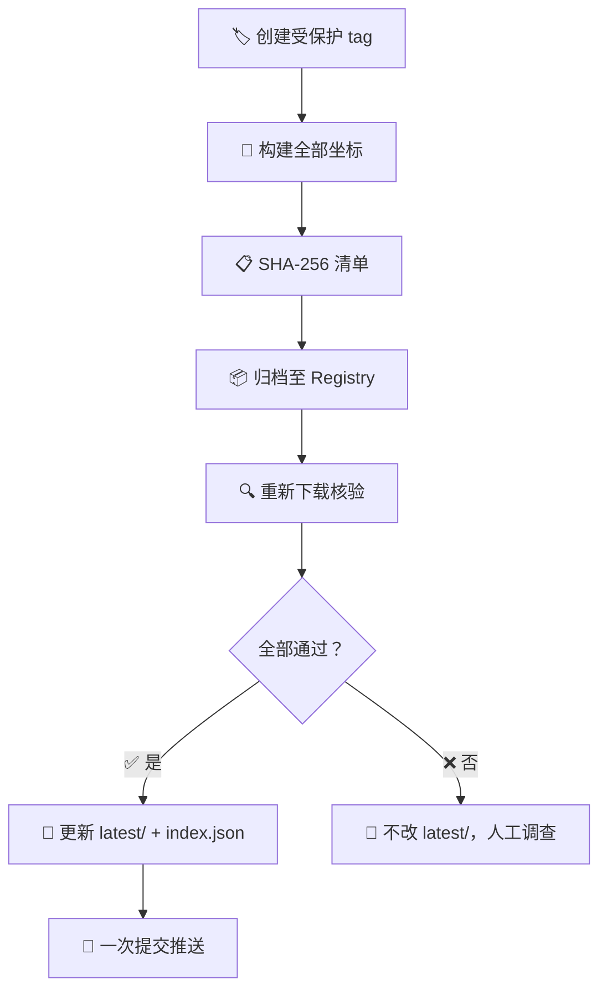

# RFC-0006：技能包版本与交付目录方案

| 字段 | 值 |
|------|-----|
| 编号 | RFC-0006 |
| 状态 | Approved |
| 作者 | zoushen |
| 日期 | 2026-09-28 |
| 变体 | standard |
| 目标版本 | TBD |
| 依赖 | [RFC-0003](../completed/RFC-0003-skill-bundle-refactoring.md)（已完成） |

## 30 秒概览

> 一句话：把 ZIP 的**历史归档**和**最新取包入口**分开管理——Registry 存历史，Git 只放最新。

**痛点**：`dist/workbuddy/` 里堆了 6 个带版本号的 ZIP，维护者分不清哪个最新；CI 只构建特定 bundle 的 `test` 环境，其他包和环境全靠手工。

**方案**：三层记录各司其职——

| 层 | 存什么 | 在哪里 | 谁用 |
|---|---|---|---|
| 🏷️ Git tag | 源码快照 | 本仓库 | 追溯构建来源 |
| 📦 Registry | 不可变的带版本 ZIP + SHA-256 | GitLab Generic Package Registry | 长期归档、审计 |
| 📂 latest/ | 每个坐标的最新正式 ZIP | `dist/<target>/latest/` | 日常取包 |

> **坐标** = `bundle ID × 版本 × target × 变体`（WorkBuddy 的变体 = 环境：coach / test / dingtalk）

## 1. 现状与痛点

RFC-0003 已完成 bundle 化：`bundle.json` 定义发布单元，`pack.py` 打包，产物落入 `dist/workbuddy/`。但——

| 问题 | 影响 |
|---|---|
| 6 个 `1.0.1` ZIP 堆在工作树，约 444 KB | 维护者在带版本号的文件中猜哪个最新 |
| CI 固定只打特定 bundle + `test` 环境 | `flashcard` 和其他环境全靠手工 |
| 任意 tag 触发，无版本校验 | 误打 tag 也会跑发布 |
| `RELEASE-NOTES.md` 用统一版本描述两个 bundle | 与 per-bundle 独立版本矛盾 |

**核心矛盾**：不是存储不够，而是**可发现性**和**发布身份**没解决。

## 2. 目标与非目标

**🎯 目标**：

- 打开 `latest/` 一眼拿到最新正式包
- 能按坐标追溯当时实际交付的 ZIP（SHA-256 可核验）
- 各 bundle 独立版本、独立发布、互不干扰
- 为新 target 预留清晰扩展路径

**🚫 非目标**：

- 不引入 Git LFS、对象存储或独立发布服务
- 不自动升版（维护者手工管理 `bundle.json.version`）
- 不重写 Git 历史
- 不替代 WorkBuddy 人工提交流程

## 3. 核心概念

### 3.1 身份：三个字段各管各的

| 字段 | 管什么 | 举例 |
|---|---|---|
| `bundle.json.id` | 内部发布身份 | `ai-customer` |
| `targets.workbuddy.source` | 宿主运行时连接器身份（写入 `connector-meta.json`） | `ai-customer` 或 `mgv-flashcard` |
| `targets.workbuddy.distributionName` | `latest/` 下载文件名前缀（不进包内） | `ai-customer` |

> 💡 **判断准则**：影响宿主注册表的 → `source`；只影响下载名的 → `distributionName`。两者可相同可不同。

`distributionName` 未声明时默认等于 `id`。新字段加在 `targets.workbuddy` 下，不改 `id`、不改包内身份。

### 3.2 目录结构：Before → After

**Before**（当前）：

```text
dist/workbuddy/
├── ai-customer-v1.0.1-coach.zip       ← 带版本号，堆在工作树
├── ai-customer-v1.0.1-test.zip
├── ai-customer-v1.0.1-dingtalk.zip
├── flashcard-v1.0.1-coach.zip
├── flashcard-v1.0.1-test.zip
└── flashcard-v1.0.1-dingtalk.zip
```

**After**（本方案）：

```text
dist/workbuddy/
└── latest/
    ├── ai-customer-coach.zip           ← 无版本号，一眼最新
    ├── ai-customer-dingtalk.zip
    ├── ai-customer-test.zip
    ├── flashcard-coach.zip
    ├── flashcard-dingtalk.zip
    ├── flashcard-test.zip
    └── index.json                      ← 机器可读索引
```

历史版本在 GitLab Registry：`generic/coachskills-ai-customer-workbuddy/1.0.2/ai-customer-v1.0.2-coach.zip`

### 3.3 索引：index.json

```json
{
  "schemaVersion": 1,
  "items": {
    "ai-customer/coach": {
      "bundleId": "ai-customer",
      "version": "1.0.2",
      "target": "workbuddy",
      "variant": "coach",
      "tag": "ai-customer-v1.0.2",
      "sourceCommit": "<构建时完整 SHA>",
      "latestFile": "ai-customer-coach.zip",
      "archiveFile": "ai-customer-v1.0.2-coach.zip",
      "sha256": "<完整 SHA-256>",
      "releaseUrl": "<GitLab Release 链接>"
    }
  }
}
```

关键规则：

- `sourceCommit` 记录**构建时**提交 SHA，发布时校验 tag 仍指向该提交（防 tag 误移）
- `releaseUrl` 避免 GitLab 迁移时断链
- 读取方必须以 `latestFile` 字段取文件，**不得从键名反推**
- 键（`发行别名/变体`）仅用于人工分组，不是 API 寻址键
- schema 演进：新增字段必须 optional；删字段必须升 `schemaVersion`

## 4. 版本规则

> 一句话：ZIP 字节变了就要升版，不改字节就不升。

| 情况 | 升版？ |
|---|---|
| 改了入包的 skill 代码 / bundle.json / 环境 URL / 图标 | ✅ 必须 |
| 只改了不入包的文档（根目录 README 等） | ❌ 不必 |
| 改了 `coach-mcp-connect`（被两个 bundle 共享） | ✅ 两个 bundle 各自检查，各自升 |
| 只改了 `flashcard_design` | ✅ 仅 flashcard 升 |

- 新增能力 → minor；兼容性修复 → patch；不兼容 → major
- 预览版用 `-rc.N`，不进 `latest/`
- **一旦发布不可覆盖**，修复后发新版本

每 bundle 新增 `CHANGELOG.md`；现有 `RELEASE-NOTES.md` 冻结为历史导航。

## 5. 发布流程



六步概要：

| 步骤 | 做什么 | 关键约束 |
|---|---|---|
| ① MR 准备 | 改代码 + 升版本 + 写 CHANGELOG + 写 release-plan.json | `check.py` 静态检查；合并前不动 `latest/` |
| ② 打 tag | 创建 `<bundle-id>-v<SemVer>` 受保护 tag | tag 与 bundle.json 的 id/version 必须精确匹配 |
| ③ 构建 | 共用 `build_bundle_zip` 函数（`pack.py` 和发布脚本走同一路径） | 同输入 → 同哈希；校验包内字段和环境端点 |
| ④ 归档 | 上传 Registry + 创建 Release | 同坐标同哈希 = 安全重试；不同哈希 = 阻断；核验失败**不主动删除**，阻断并隔离 |
| ⑤ 提升 | 复制 ZIP 到 `latest/`，更新 `index.json` | **全有或全无**；碰撞检测读默认分支实际索引 + 本次计划；推送冲突指数退避重试（最多 3 次） |
| ⑥ 渠道交付 | 人工提交 WorkBuddy | Release 描述分两段：**机器资产**（自动维护）+ **人工渠道状态**（仅人工更新，不随重试覆盖） |

### 发布矩阵：release-plan.json

```json
{
  "version": "1.0.2",
  "targets": {
    "workbuddy": ["coach", "test", "dingtalk"]
  }
}
```

不可变、非空、坐标不重复、版本匹配 bundle.json。重跑同 tag 必须得到相同计划。

## 6. 备选方案

| 方案 | 优点 | 为什么没选 |
|---|---|---|
| A. 每版 ZIP 全放 Git | 最直观 | 二进制累积，"提交了" ≠ "已交付" |
| B. 只留 tag，按需重建 | 存储少 | 无法证明"当时交付的字节" |
| C. 全放 CI artifact | 实施快 | artifact 会过期，不适合长期归档 |
| **D. Registry 存历史 + Git 存最新** | 兼顾追溯和取包 | 需配置 Registry（选定 ✅） |

> 分层模型参考了 npm dist-tag、crates.io yank 语义和 Go module proxy 的通用做法。

## 7. 影响与代价

**✅ 正面**：一眼取包、历史可追溯、各 bundle 独立、流程可审计

**⚠️ 负面**：

- 需配置 GitLab Registry 和发布作业
- 流程变长（六步），需理解"归档 → 核验 → 提升"三段
- `latest/` 在工作树每坐标一份（不随版本增长），但 Git 历史仍会累积
- 旧 ZIP 迁移需人工盘点

## 8. 实施计划

| 阶段 | 做什么 | 风险 |
|---|---|---|
| **0. 基础设施确认** 🚧 | 对 GitLab 实例实测 Registry upload/download/delete | 前置门禁：不通过则暂停 |
| **1. 基础设施准备** | 配 Registry 权限 + 受保护 tag + CI credential | 需 GitLab 管理员配合 |
| **2. 脚本改造** | 新增 `release_bundle.py`（plan/archive/promote 子模块）；从 `pack.py` 抽出共用 `build_bundle_zip`；`check.py` 新增 `release-plan` + `distribution` 检查项 | 需充分测试 |
| **3. CI 改造** | 三阶段 pipeline（构建 → 归档 → 提升）；手动触发全链路验证 | 确认 Runner 支持 |
| **4. 测试覆盖** | tag 校验、碰撞检测、哈希核验、降级防护、别名变更、跨 target 隔离 | — |
| **5. 旧 ZIP 迁移** | 逐个 ZIP 记录交付证据 + 归档哈希；条件未满足的暂留原路径 | 历史记录不完整 |
| **6. 文档切换** | 更新 releasing.md、安装文档、README | — |

## 9. 测试计划

**静态检查**：`check.py` 校验别名、release-plan、changelog、文件名碰撞

**单元测试**：tag/version 解析、碰撞检测、哈希核验

**集成测试**：dry-run 模拟完整流程（注意：dry-run 不验证真实上传/下载/Release/push 权限）

**Fitness function**：

- 发布 bundle A 不改 bundle B 的最新文件
- 同坐标同哈希可重试，不同哈希拒绝
- 任一坐标失败 → 所有 `latest/` 保持原样
- 不同坐标不生成同名文件

## 10. 开放问题

| # | 问题 | 状态 |
|---|---|---|
| 1 | ⚠️ **coach-mcp-connect 测试 URL 硬编码**——coach/dingtalk 发布的前置阻塞 | 需单独 issue |
| 2 | Registry 权限模型——GitLab 有权限者可删包，需确认备份责任 | 待运维确认 |
| 3 | 旧 ZIP 迁移——无历史 tag，需维护者逐文件签字确认 | 待排期 |
| 4 | Registry 不可用降级——触发条件：API 连续 3 次失败或超时 5 分钟 | 已定义 |
| 5 | `RELEASE-NOTES.md` 是否加"旧式汇总"标注 | 待确认 |
| 6 | 简洁性迭代未达 8.5——index.json 键设计和 release-plan 维护成本可优化 | 实施阶段评估 |

## 参考依据

- [GitLab Generic Package Registry](https://docs.gitlab.com/user/packages/generic_packages/)
- [GitLab Releases](https://docs.gitlab.com/user/project/releases/)
- [npm unpublish](https://docs.npmjs.com/unpublishing-packages-from-the-registry/)
- [crates.io yank](https://doc.rust-lang.org/cargo/commands/cargo-yank.html)
- [Go module proxy](https://go.dev/ref/mod#module-proxy)
- [Reproducible Builds](https://reproducible-builds.org/docs/definition/)
- [SemVer](https://semver.org/)
