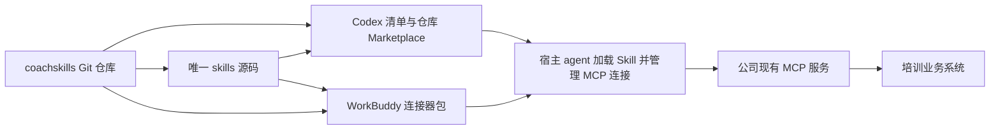
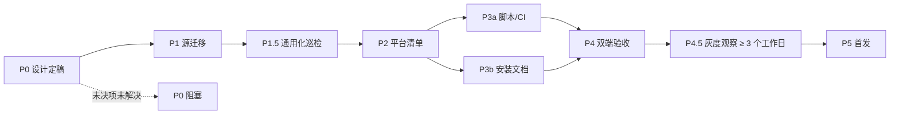

# RFC-0001：沿用 Superpowers 架构建设公司 Skills 仓库

| 字段 | 值 |
|------|-----|
| 编号 | RFC-0001 |
| 状态 | Completed |
| 作者 | zoushen |
| 日期 | 2026-09-14 |
| 变体 | standard |
| 目标版本 | coachskills v0.1.0（建议的首个仓库版本） |

## 核心概览

**核心概要**：采用 Superpowers 的仓库组织和分发模式：仓库根目录就是一个插件，所有公司技能放在根 `skills/`，平台清单引用同一份源码，整个插件使用一个版本。本项目保存、维护和发布”如何使用公司能力”的指令及连接信息；培训工具继续由现有 MCP 服务实现。

首期整合 `/home/zoushen/.claude/skills/ai_customer_design`，提供 Codex 原生插件和 WorkBuddy MCP＋Skill 连接器。Codex Marketplace 直接指向本仓库根插件；WorkBuddy 通过少量维护脚本生成连接器包。不增加 `bundles/`、`packages/`、业务 tools、MCP SDK、数据库、管理网站或独立发布服务。

**通用性基线（用户新增约束）**：SKILL.md 与 references 不得包含 Claude Code / Anthropic SDK 私有术语或宿主专属路径；通用基线用例在 Codex / WorkBuddy / Claude Code / Aider / Cursor / Continue.dev 六个宿主上”文本可读、调用可达”；不假设宿主提供 thinking / hooks / sessionStart 等私有机制。详见 §3.6.1、§3.14。

**已明确的需求与本稿默认决策**：

- 用户已明确：以 Superpowers 架构为参照，业务工具在远程 MCP 中，本轮交付详细 spec，不实施代码。
- 用户已明确：以指定的本地 `ai_customer_design` 目录为整合源，不以旧压缩包为基准。
- 用户已明确：skill 要脱离 Claude Code 专用 skill 的印记，做到不同 agent 通用。
- 本稿默认：公司仓库先整体发布为一个插件 `coachskills`，内含一个 `ai_customer_design` Skill；发布粒度尚未得到本轮额外确认。
- 本稿默认：首期支持 Codex 本地客户端与 WorkBuddy 桌面连接器；其他宿主和公开市场上架按需另增，但通用性基线作为可审计的判定标准贯穿全程。
- 本稿决策：保留现有二维码业务要求，只提取必要的本地 QR 辅助函数，缺少 Python 运行时给出降级路径；不把完整 Python MCP 客户端带入默认发布路径。



## 1. 背景、证据与合理性判断

### 1.1 当前项目与整合源

本项目目前只有 GitLab 默认 `README.md`，远程仓库为 `git@git.mgvai.cn:coach/coachskills.git`。代码库无现成的 Skill 注册、平台打包或发布实现。文中未来目录、脚本、命令和验收均是拟实施契约，不表示已经存在或测试通过。

指定整合源包含 `SKILL.md`（编写本稿期间为 571–594 行，**源仍处于活跃修改中**；2026-09-14 23:50 实测 582 行）、1,257 行 `scripts/mcp_client.py`、segno 依赖和安装说明。源技能明确以原生 MCP 调用为主，Python `call/stream` 是备选，二维码渲染是唯一明确强制使用的本地脚本能力。当前目录还包含调试日志，不应整体复制发布。

| 本次源码证据 | 发现 | 设计影响 |
|---|---|---|
| `SKILL.md:10–18` | 原生 MCP 前提、备选客户端、本地二维码 | 无需实现业务 tools 或通用 CLI |
| `SKILL.md:26–68、150–154` | 对话结束与课程建成分开判定 | 整合必须保留业务验证规则 |
| `SKILL.md:139–140、529` | 不确定结果不得直接重放 chat | 需要异常路径行为验收 |
| `SKILL.md:340–371` | 原始文档上传并传递 fileIds | 不得在精简时退化为文本摘录 |
| `SKILL.md:404–442` | 二维码和原始链接均需展示 | 本地 QR 暂不能直接删除 |
| `SKILL.md:466、509、512` | 个人路径和 Claude 固定目录 | 改为技能根目录相对引用 |
| `SKILL.md:526、546–571` | 平台登录与脚本登录混用 | 默认流程统一宿主原生授权 |
| `scripts/mcp_client.py:77–84` | 固定测试地址与 660 秒超时 | 测试地址不代表生产配置；脚本超时不代表宿主超时（引用源文件措辞） |
| `scripts/mcp_client.py:945–979` | 独立 QR 函数，无业务网络依赖 | 可提取最小辅助脚本 |

这些行号相对于 2026-09-14 首次调研时的 571 行版本（SHA 见下）；**源文件其后仍在被修改，行号已漂移**（例如原 L466 的个人路径段现为他处内容）。P1 导入前必须重新取证：重算行号与哈希、审查差异、确认无未评审的业务规则变更——这是 M01 的硬性前置。取证快照：

```text
SKILL.md（2026-09-14 首次调研，571 行）
299b045c4bd7bb2664c5980dc11d61d7ea65e3f0660682ff378cfd6a6fbeb0bb
SKILL.md（2026-09-14 23:50 复核，582 行）
01a7084e97219c6a58e7f1ca586a84103a02c74ca9a0412394dbc691bc072a8b
scripts/mcp_client.py
2be49f6984fe0051ea06f9fa60a28d80d704c8155f436ee624c3ce821c495503
```

实施时以最新复核值为准并再次重算；若源目录继续变化，先审查差异再导入。以上哈希仅标识调研快照。

### 1.2 Superpowers 实际架构

本次检查的是上游 `6.3.0`，固定 commit `b36e0829c6d0140e93cfef2ca599b1b07d4a7797`，提交日期为 2026-08-12。已读取真实清单、发布脚本和相关测试，未执行上游 hooks 或发布脚本。

| 上游实现 | 借鉴方式 | 不直接复制的内容 |
|---|---|---|
| 根 `skills/`，Codex 清单引用 `./skills/` | 根目录维护一份公司技能源码 | Superpowers 编程方法论正文 |
| `.codex-plugin/` 等平台清单并列 | 平台接入与技能正文分离 | 未使用的平台目录 |
| 仓库内 `.agents/plugins/marketplace.json` | 本仓库同时提供市场目录和插件源码 | 未经验证的源类型写法 |
| `.version-bump.json` 与版本脚本 | 全仓一个版本并校验平台字段 | 为版本号额外引入 Node 包 |
| 固定 Git ref、白名单打包与校验和 | 可追踪的发布包 | 其历史官方包元数据、特定公有仓库 PR 流程 |
| `sync-to-codex-plugin.sh`（15KB）＋ `tests/codex-plugin-sync/` | 按平台转换内容需配套同步脚本与测试——验证了本稿 build.py frontmatter 投影的思路 | 其同步的具体转换规则 |
| 4 个扁平 shell 维护脚本、无 CI workflows、无提交的 dist/校验和 | 极简维护面：不做字节级可重复构建，发布资产即权威产物 | —（本稿仅因公司 GitLab CI 与生产 MCP 门禁需要保留最小 CI） |
| hooks 和运行时扩展 | 首期不采用 | 全局强制调用 Skill、SessionStart 注入、视觉 companion |

上游当前没有 WorkBuddy 清单，也没有可直接复用的培训 MCP 配置；检查中未发现 `.github/workflows`。因此“沿用架构”合理，“复制上游就自动完成两平台注册和发布”不成立。[上游固定快照](https://github.com/obra/superpowers/tree/b36e0829c6d0140e93cfef2ca599b1b07d4a7797)

### 1.3 两个平台的必要差异

两者都能把 Skill 指令与 MCP 服务关联为可安装能力。业务正文共享，差异集中在清单字段、展示元数据和发布入口。

| 维度 | 本稿选择的 Codex 路径 | WorkBuddy 路径 |
|---|---|---|
| 清单 | `.codex-plugin/plugin.json` | `connector-meta.json` |
| MCP 配置 | `.mcp.json`，由兼容清单引用 | 根 `mcp.json` |
| Skills | 根 `skills/` | 根 `skills/` |
| 分发 | 本仓库 Git Marketplace | 连接器提交包 |
| 服务范围 | 本稿仅配置一个 MCP | 一个连接器限一个 MCP |
| 更新 | 刷新市场并验证安装版本 | 更新后重新提交审核 |

Codex 官方推荐的新格式是根 `plugin.json` 和 `mcp.json`，但仍支持 Superpowers 使用的兼容布局。本稿为贴近上游明确选择兼容布局，首期不同时创建 portable 根清单，以免两种发现规则混用。WorkBuddy 的 `.workbuddy-plugin/` 仅是本仓库保存平台资料的约定，客户端不会自动识别它；必须打包为其官方根结构。[Codex 插件打包](https://developers.openai.com/plugins/build/plugins)、[WorkBuddy 连接器](https://open.workbuddy.cn/docs/connector)

## 2. 目标与非目标

### 2.1 可验收目标

| ID | 要求 | 当前值 → 目标值 |
|---|---|---|
| G01 | 统一存储 | 0 个仓库内 Skill → 1 个已迁移的 `ai_customer_design` |
| G02 | 单一源码 | 个人安装目录为源 → 仓库根 `skills/` 为唯一维护源 |
| G03 | 双平台交付 | 0 个平台清单 → Codex 插件和 WorkBuddy连接器包 |
| G04 | 原生工具路径 | 指令混有脚本登录 → 默认业务调用及授权全走宿主 MCP 客户端 |
| G05 | 可追踪版本 | 无仓库版本规范 → commit、插件版本、tag 一致；ZIP 产物哈希记录于 SHA256SUMS（仅离线交付核对；Git Marketplace 渠道直接使用 Git 快照，见 §3.10） |
| G06 | 升级闭环 | 未验证 → 两个平台各完成一次旧版升级与新会话验证 |
| G07 | 业务保持 | 未迁移 → 建课、改课、文档、结果确认、链接和二维码行为保持（QR 交付以宿主具备 Python 运行时为前提，降级口径见 §3.8） |
| G08 | 跨宿主通用 | 源 skill 残留宿主绑定描述 → 双层判定：①文本可读层——SKILL.md/references 达到 §3.14 通用化基线（8 条规则，T05-b/T13–T16 审计），六宿主 X01–X03 加载可读；②调用可达层——Codex/WorkBuddy 首期实测通过（E01–E11），其余四宿主 X04–X06 按占位记录（含失败记录），其"调用可达"为**有条件结论**（以 §8 双认证 + HTTP 直连两项未决前提为准，未确认前不承诺） |

### 2.2 非目标

- 不重写业务 MCP、课程服务、OAuth 服务或长任务执行框架。
- 不新增业务 `tools/`、通用 MCP Python SDK、用户侧安装器或认证 CLI。
- 不引入包依赖解析、按 Skill 独立版本、能力包嵌套和多仓发布同步系统。
- 不引入管理网站、数据库、安装遥测或自动更新后台进程。
- 不在首期接入其他智能平台、OpenAI 公开插件目录或工作空间 GitHub 镜像。
- 不复制 Superpowers 的全局方法论 Skill 和启动 hooks。
- 不复用 Superpowers 的命名空间（如 `using-superpowers`、`brainstorming`、`writing-skills`）作为本仓库 Skill 名。
- 不携带任何 Claude/Anthropic 私有 frontmatter 字段（`Use when`、`Only use`、`<when_to_use>` 等）；不假设任何宿主提供内置 hooks、`thinking`、`sessionStart` 注入。
- 本 RFC 只落设计；实际发布、安装及测试执行在实施阶段进行。

## 3. 决策与核心设计

### 3.1 ADR-01：一个仓库就是一个公司插件

选定结构如下。只有实际使用的目录进入首期，不为未来能力创建空骨架。

```text
coachskills/
├── .agents/plugins/marketplace.json
├── .codex-plugin/plugin.json
├── .mcp.json
├── .workbuddy-plugin/
│   └── connector-meta.json
├── skills/
│   └── ai_customer_design/
│       ├── SKILL.md
│       ├── references/
│       │   ├── course-workflows.md
│       │   ├── file-upload.md
│       │   ├── result-and-progress.md
│       │   └── troubleshooting.md
│       ├── scripts/render_qr.py
│       └── vendor/segno/              # 含 LICENSE（BSD 三条款，P1 前补齐，见 §3.8/§8）
├── assets/icon.svg
├── scripts/                   # 维护工具：上游为 4 个扁平 shell 脚本；本稿因需 YAML frontmatter 投影用 Python，但不引入 lib/ 分层
│   ├── check.py
│   ├── build.py
│   └── bump_version.py
├── tests/
│   ├── test_packaging.py
│   ├── test_versioning.py
│   ├── test_render_qr.py
│   ├── e2e_base/              # E_base 通用基线验证脚手架（测试专用，不入发布包）
│   └── scenarios/ai_customer_design.md
├── docs/
│   ├── installation/codex.md
│   ├── installation/workbuddy.md
│   ├── releasing.md
│   ├── migration/ai_customer_design.md          # 含 M03 绑定映射表 + M01 源入口记录
│   ├── mcp-contract/tools-list-snapshot.json   # idempotent 工具清单与服务端核对快照（§3.13）
│   └── rfcs/draft/RFC-0001-superpowers-style-company-skills.md
├── requirements-dev.txt
├── .gitlab-ci.yml
├── .gitignore
├── README.md
├── RELEASE-NOTES.md
└── dist/                         # 忽略；仅生成产物
```

根 `scripts/` 是维护工具，运行在维护者或 CI 环境；`skills/*/scripts/` 是确有必要的技能辅助资源。两者不得混淆。源目录不通过符号链接指向个人 `.claude` 目录；发布包内也不使用符号链接。

未来新增技能放 `skills/<skill-name>/`。当前统一包内所有依赖远程服务的 Skill 必须使用同一个 MCP 服务。若新增能力依赖第二个独立 MCP 或不同发布/权限边界，再另立分包设计；不为绕过 WorkBuddy 限制而在本项目新建聚合网关。

### 3.2 ADR-02：身份、清单与版本源

| 项目 | 首期约定 |
|---|---|
| 仓库和插件 ID | `coachskills` |
| Codex Marketplace ID | `coachskills-marketplace` |
| WorkBuddy source | 拟用 `mgv-coachskills`，首次注册时确认可用性 |
| MCP 本地连接键 | `enterprise-training` |
| 初始 Skill 名 | `ai_customer_design`，保持不变 |
| 唯一版本源 | `.codex-plugin/plugin.json` 的 `version` 字段 |
| 版本序列 | 首个预览 `0.1.0-rc.1`，验收通过后 `0.1.0` |

版本号标识本仓库插件，与旧压缩包 `ai_customer_design-1.0.0` 没有数值继承关系。首次接入后不得随版本变更随意修改 plugin name、marketplace name、WorkBuddy source 或 Skill name。

建议的最小 Codex 清单：

```json
{
  "name": "coachskills",
  "version": "0.1.0-rc.1",
  "description": "通过公司 MCP 服务完成培训课程创建、修改和查询。",
  "author": {"name": "MGV"},
  "skills": "./skills/",
  "mcpServers": "./.mcp.json",
  "hooks": {},
  "interface": {
    "displayName": "公司培训技能",
    "shortDescription": "连接公司培训服务并完成课程工作流",
    "developerName": "MGV",
    "category": "Productivity"
  }
}
```

`MGV` 和展示文案为待业务负责人核定的默认值。清单采用兼容格式并须经过所支持客户端的真实加载验证。`hooks: {}` 明确不提供 hooks；不创建 `hooks/` 目录。不得照搬上游品牌、隐私条款 URL、官方应用 ID 或许可字段。

### 3.3 Codex Marketplace 与安装契约

使用文档规定的本地路径类型，路径相对 Marketplace 根：

```json
{
  "name": "coachskills-marketplace",
  "interface": {"displayName": "公司 Skills"},
  "plugins": [
    {
      "name": "coachskills",
      "source": {"source": "local", "path": "./"},
      "policy": {"installation": "AVAILABLE", "authentication": "ON_INSTALL"},
      "category": "Productivity"
    }
  ]
}
```

上游快照使用的是 `source: "url", url: "./"`；本稿不将该写法当作通用标准，采用官方本地路径形式。**本稿固定使用 Codex 兼容布局（`.codex-plugin/plugin.json` + 根 `.mcp.json`），不切换 portable 根清单布局**（portable 将 `mcpServers` 等字段置于 `extensions.com.openai` 下，两种发现规则不混用；若未来 Codex 弃用兼容布局，按 §3.11.1 兼容性窗口迁移）。根插件 `./` 的实际加载、缓存范围和重复发现情况必须在实施阶段验收（P0 即做 0.5 天安装 spike，见 §6；失败则本渠道降级为 ZIP 离线交付）；静态 JSON 合法不足以证明可安装。`authentication: "ON_INSTALL"` 与宿主 MCP OAuth 的触发时序（install 时授权 vs 首次调用时授权、是否双重弹窗）在 P0 spike 中一并实测记录；若与 E02 观察到的实际流程不符，改用平台支持的其他 policy 值。

拟定使用流程：

```bash
# 首次安装：固定一个已经验收并发布的版本。
codex plugin marketplace add git@git.mgvai.cn:coach/coachskills.git --ref v0.1.0
codex plugin add coachskills@coachskills-marketplace

# 查看市场；固定 tag 的市场不会自动追踪下个版本。
codex plugin marketplace list
codex plugin marketplace upgrade coachskills-marketplace
```

这些命令是目标用法；本机此前检查的 Codex CLI 为 0.153.4，仅确认了相关命令帮助，未证明公司 Git 源已可安装。安装指南须标注实际测试的客户端版本、私库 SSH/HTTPS 访问前提以及 OAuth 步骤。

稳定更新可使用受保护的 `stable` 分支：只允许指向已发布 tag 的相同源码 commit，不保存第二份生成源码。追踪 `stable` 的用户执行 refresh 后仍须检查已安装版本及新会话行为。固定 tag 用户由安装指南提供经验证的切换 ref 方法；不凭猜测承诺重复 `marketplace add` 会覆盖旧配置。移除市场后重加、重新安装等操作仅作为真实验收后的操作步骤记录。

Git Marketplace 是首期正式 Codex 渠道，ZIP 仅供离线交付和后续入口使用，不能表述为所有 Codex UI 都可直接上传安装。工作空间导入的 GitHub 限制和公有目录审核不属于该渠道。[Codex 工作空间分发边界](https://learn.chatgpt.com/docs/enterprise/plugin-management)

### 3.4 ADR-03：MCP 配置只维护一个地址

根 `.mcp.json` 是 MCP 地址的唯一维护源。首期开发配置可以使用现有测试地址，须显式标注测试用途：

```json
{
  "mcpServers": {
    "enterprise-training": {
      "url": "https://mcp.test.omnimay.com/coach/mcp"
    }
  }
}
```

所有正式安装均由宿主 MCP 客户端管理登录。Skill 不读取本地 tokens 文件，不调用脚本 `auth`，不要求用户粘贴长期 Token。WorkBuddy 使用服务端自带 OAuth 的接入模式，省略 `auth_mode`，不复制 Token 模式示例的固定 Authorization header。

构建器只从明确字段读取数据，生成 WorkBuddy 配置：

```json
{
  "mcpServers": {
    "enterprise-training": {
      "type": "streamableHttp",
      "url": "https://mcp.test.omnimay.com/coach/mcp"
    }
  }
}
```

不做 JSON 文件直接改名，不自动转发未知字段。当前构建器仅支持单个 HTTPS 远程 MCP、无内嵌凭证的上述配置；遇到第二个 server、stdio、自定义认证头或未知字段时明确失败，待设计评审后扩展。

环境规则：开发 commit 可指向测试服务；生产发布 commit 必须将根地址配置为已经确认的生产 URL。`--release` 校验要求 CI/维护者提供 `PRODUCTION_MCP_URL`，与源配置逐字匹配，且不允许示例地址、测试地址、用户信息或凭证 query。该变量是发布目标校验值，不用于静默重写包内容。正式 URL 未知时可以完成预览构建，但不得发布生产 tag 或推动 stable。

首期不增加环境配置框架。测试特殊端点时使用单独工作副本，生成明确标为 dev 的包，不覆盖正式产物或稳定市场。

### 3.5 WorkBuddy 连接器元信息

`.workbuddy-plugin/connector-meta.json` 保存 WorkBuddy 专用元信息；文件名和目录中的平台前缀不构成 WorkBuddy 自动发现机制。该目录内文件仅作为构建源，实际包内根结构由构建器重写。

<!-- TODO(pending business owner): name/name_zh/name_en/description/source/minWorkbuddyVersion/category 需业务负责人核定 -->

```json
{
  "name": "公司培训技能",
  "name_zh": "公司培训技能",
  "name_en": "Company Training Skills",
  "description": "Create and manage training courses through the company MCP service.",
  "description_zh": "通过公司培训服务创建、修改和查询课程，并生成练习入口。",
  "description_en": "Create, edit and query training courses and generate practice links.",
  "source": "mgv-coachskills",
  "type": "mcp",
  "version": "0.1.0-rc.1",
  "minWorkbuddyVersion": "4.24.0",
  "examples_zh": ["创建一个销售沟通训练课程", "查询已有培训课程"],
  "examples_en": ["Create a sales conversation training course", "List existing training courses"]
}
```

`minWorkbuddyVersion: 4.24.0` 是所选字段的文档基线，不是已验证的产品支持下限；P0 期间用手工预览包在 ≥2 个版本跨度的客户端预检（§6 P0 附加项 ②），正式包 P3a 后复核；真实安装验收后如需调整最低版本，必须修改清单并把该字段纳入 §8 的"平台最低版本变更"监控项。`minWorkbuddyVersion` 仅 WorkBuddy 读取，其它宿主忽略。版本字段由版本同步脚本维护，不通过构建静默修正源码中的版本冲突。

`assets/icon.svg` 作为共享品牌资源，构建时复制为 WorkBuddy 根 `icon.svg`；WorkBuddy 对 SVG 的具体渲染要求（尺寸/单色约束）在 P2 手工预览包验证时一并确认，icon 本身不阻塞仓库建设。`source` 名称是否可注册、企业可见范围及发布账号需在正式提交前确认；`source` 注册被占用时的回退命名策略（如 `mgv-coachskills-2` / 更换组织前缀）由业务负责人在 P2 前给出。预览包的预发布版本是否被提交端接受也须验证；不接受时预览仅在开发测试入口验证，不冒用已上线正式版本，且 WorkBuddy 侧 E09 升级闭环按 §7.2.2 E09 契约顺延。

### 3.6 Skill 格式与平台元数据

根 `skills/ai_customer_design/SKILL.md` 保留标准 `name` 和 `description`，将 WorkBuddy 所需本地化文案放在标准 `metadata` 字符串映射中。

**通用性原则**：本 frontmatter 仅写 `name` + `description` + `metadata`（可选 `license`）；任何 Claude/Anthropic SDK 私有字段一律不写；`allowed-tools` 不写以避免跨宿主兼容问题。例如：

```yaml
---
name: ai_customer_design
description: 创建和修改公司培训课程、上传课程资料、查询课程并生成练习链接。触发关键词：建课、AI 客户课程、AI 设计师对话、改课、查询培训课程、生成练习链接。
metadata:
  description_zh: 创建和修改公司培训课程，上传资料并生成练习入口。
  description_en: Create and edit company training courses and generate practice links.
---
```

WorkBuddy 构建仅修改 frontmatter：将上述两项投影为顶层 `description_zh`、`description_en`，写入插件版本 `version` 以及清单作者 `author`。保留 `name`、`description` 和源 metadata；同名顶层字段若已存在且值冲突则失败。Codex 包直接使用源文件。

分隔符后的 Markdown 正文必须逐字节一致，资源文件内容必须一致；不得在构建时用大模型改写、不做宿主→宿主全局词替换。正文统一使用”宿主””宿主 MCP 客户端””宿主环境 MCP 工具”等中性描述。维护依赖使用 YAML 解析器，并明确处理 UTF-8、LF 和 frontmatter 边界，不用正则表达式替代完整 YAML 解析。

引用采用技能根目录相对 Markdown 链接；WorkBuddy 对这些链接的实际资源加载列为验收项。不同宿主的 `allowed-tools` 语法和名称未统一，首期不设置该字段（见 §3.14 第 1 条），以免错误限制正常工具使用。

#### 3.6.1 跨宿主中性化基线（操作化禁用表）

本节是 §3.14 通用化设计原则的**操作化明细表**；规范权威定义在 §3.14，若两处表述冲突以 §3.14 为准。适用于 SKILL.md frontmatter、主文件正文、references 三处：

| 类别 | 禁用 | 替换为 |
|---|---|---|
| 触发短语 | `Use when` / `Only use` / `<when_to_use>` / `Use this skill when` | “触发关键词：……” 或 “动作 + 对象 + 场景” 句式 |
| 宿主名称 | `Claude Code` / `Anthropic` / `Codex` / `WorkBuddy` / `Cursor` / `Aider` / `Continue.dev` 单点指向 | “宿主” / “宿主 agent” / “宿主 MCP 客户端” |
| 私有目录 | `~/.claude/` / `~/.codex/` / `~/.workbuddy/` / `~/.cursor/` / `~/.aider/` / `~/.continue/` | `<skill-root>` / `<host-config-dir>` 占位 |
| 运行时机制 | `SessionStart` / `StatusLine` / `Hook` / `thinking` / `tool_use` / `subagent` / `Task 工具` | “宿主启动钩子” / “宿主状态行” / “宿主钩子” 等中性描述，或明确”由宿主实现” |
| SDK 字段 | `_meta.progressToken` / `tool_use_id` / `claude_code_*` 字段 | “宿主 MCP SDK 注入” / “由宿主 MCP 客户端处理” |
| 私有 frontmatter | Anthropic Skills 私有触发短语 / 私有 metadata 字段 | 按 §3.14 第 1 条 frontmatter 白名单执行；本地化文案放 metadata 字符串映射 |

校验由 `scripts/check.py --release` 在 frontmatter 提取阶段按 §3.14 执行，测试挂载统一见 §3.14 末尾。

#### 3.6.2 已知宿主差异点附录（占位）

下表只列**已知的、不影响通用基线、需在构建器/安装文档中各自处理的差异点**，不写任一宿主专属章节。首期闭环 = Codex + WorkBuddy；其余宿主作”非首期支持但文本可读”。

| 维度 | Codex | WorkBuddy | Claude Code | Aider | Cursor | Continue.dev |
|---|---|---|---|---|---|---|
| Skill 目录 | 仓库根 `skills/` | 连接器包 `skills/` | `~/.claude/skills/` 或项目级 `skills/` | `.aider*` 配置 | `.cursor/rules` | `.continue/config.json` |
| frontmatter 识别 | 是 | 是 | 是 | 部分 | 部分 | 部分 |
| metadata 字符串映射 | 否 | 是 | 否 | 否 | 否 | 否 |
| MCP servers 字段 | `mcpServers` | `mcpServers` | `mcpServers` | 无原生 MCP | IDE 配置 | 配置项 |
| 原生 OAuth | system browser | 自家账号体系 | system browser | 走 API key | 走 API key | 走 API key |
| Marketplace 概念 | 有 | 无 | 无 | 无 | 无 | 无 |
| QR helper 前提 | Python 运行时 | Python 运行时 | Python 运行时 | Python 运行时 | Python 运行时 | Python 运行时 |

宿主能力差异导致”宿主 MCP 客户端调用”在不支持 MCP 的宿主上降级为 HTTP 直连（降级的真实可操作性见 §8 开放问题——未验证前不作承诺）。MCP 服务 `enterprise-training` 若要覆盖 Token 认证宿主（Aider/Cursor 等）需支持双认证（OAuth + Token）——**该前提未确认**，列入 §8 由 MCP 服务团队决议；未支持前 X04/X05 按占位记录，不承诺。

引用：[Agent Skills 规范](https://agentskills.io/specification)、[WorkBuddy Skill 元数据](https://open.workbuddy.cn/docs/skill)

### 3.7 `ai_customer_design` 迁移契约

迁移采用”白名单导入、保留业务、删除宿主耦合”，不是重新设计培训流程。

迁移文档 schema（`docs/migration/ai_customer_design.md` 必含字段）：源入口记录（M01：源路径 + 迁移时 SKILL.md/mcp_client.py 哈希与行数）、M03 绑定映射表（源章节段 → 目标文件，逐段核销状态）、M10 源文档处置记录（INSTALL.md/README.md 各段去向）、P1 期间人工巡检结果（P1.5 grep 命中清单及改写对照）。

| 要求 ID | 必须实施的动作 | 保留或验证的行为 |
|---|---|---|
| M01 | 源入口记录于 migration 文档，复制后独立维护 | 不再从个人目录动态同步或安装时读取 |
| M02 | 主文件保留触发条件、前提、核心工作流和关键异常；触发条件按”动作 + 对象 + 场景”重写，去除 Anthropic 私有触发短语 | 无关请求不触发培训技能 |
| M02-c | 业务前提与触发段必须改写为宿主中立表述；不假设宿主提供 thinking / hooks / sessionStart 注入 | 六个目标宿主（Codex、WorkBuddy、Claude Code、Aider、Cursor、Continue.dev）的通用基线用例可执行 |
| M03 | 详细流程按”独立决策分支数”拆到 references；主文件必须自包含一条最小执行路径，不读 references 也能完成最常见 1 个用例（**绑定映射**：迁移前先建立"源 SKILL.md 章节段 → 目标文件"映射表写入 migration 文档，拆分后逐段核销，源文件无孤儿段落、目标文件无无源内容）。绑定映射拟定：触发与前提段→主文件；建课/改课/查询工作流→references/course-workflows.md；文档上传→references/file-upload.md；结果核实与进度→references/result-and-progress.md；异常排查→references/troubleshooting.md；最常见 1 用例 = **新建课程（含结果核实）**——建课是源技能的主流程且覆盖双完成判定规则 | 不因拆分丢失结果验证、文档上传、改课规则 |
| M04 | 工具由宿主 MCP 客户端发现并调用 | 不建立业务工具包装层；显示名称有宿主前缀时按真实工具列表映射 |
| M04-c | 工具前缀与 schema 由 MCP `tools/list` 解析，禁止硬编码 Claude/Anthropic SDK 假设 | 在不支持 MCP 的宿主上降级为 HTTP 直连 |
| M05 | 授权失败引导”由宿主 MCP 设置重新连接”，不点名具体客户端 | 不把脚本 OAuth 当作宿主连接修复 |
| M06 | 移除所有宿主私有目录占位符（`~/.claude/`、`~/.codex/` 等），统一用技能根相对路径或 `<host-config-dir>` 占位 | Skill 在插件缓存任意路径下可使用 |
| M06-c | 所有相对路径相对 skill 根目录；不携带任一宿主的私有目录示例 | 通用基线用例在六宿主下可执行 |
| M07 | 移出测试环境阶段性经验，标记适用日期与服务版本 | 不将”秒拒”等现象直接断言为确定的后端原因 |
| M08 | 不携带旧 MCP 客户端、旧安装脚本、日志或缓存；不携带 `~/.claude/` / `~/.codex/` / `~/.workbuddy/` 等具体宿主路径示例 | 业务调用不使用**本地捆绑客户端**（指旧 `mcp_client.py` 本地代理传输及其 Python fallback）；宿主缺少 MCP 客户端时按 §3.14 规则 6 走**远程 streamableHttp 直连**降级指引，该指引写入 references 并标注"仅非首期宿主适用"，不属于 M08 禁止范围 |
| M09 | 同步替换仓库根 `README.md` 为项目说明，不保留 GitLab 默认模板 | 不混用”Getting started with GitLab” / “Add your files” / “Test and Deploy” 等模板段落 |
| M10 | 源 `INSTALL.md`（123 行）与 `README.md`（74 行）不整体迁移：安装说明按 §3.1 重写为 `docs/installation/codex.md` / `workbuddy.md`（宿主中立、去除个人路径与脚本登录指引）；源 README 中仍适用的高层简介并入新根 README（M09） | 源文档中的宿主专属安装步骤（如 Claude Code 个人目录安装）不进入新仓库 |

必须保留的关键业务规则（错误码挂接见 §3.13）：

- `status: completed` 或 AI 回复不能单独证明课程建成；最终读取 `get_ai_customer_config` 核实 `create_status_created` 与非空阶段，其他业务字段按流程检查。
- “结果不确定”与断流场景不能盲目重放建课 chat，先读取课程实际状态，无法确认则报告不确定。（`E-MCP-UNCERTAIN`）
- 原始附件按源技能的上传路径处理，保留 `metadata.fileIds`；不能以摘要替换原始文档上传。
- 改课先记录基线，再读取配置核实实际变化，不能只转述 AI 自称完成。
- 保留练习链接及二维码两项交付，明确报告辅助步骤失败。

主流程可以描述核心工具及典型参数，但不复制整个 MCP tools/list schema 作为另一个权威定义。源技能中尚未确认的 schema 不得在迁移时擅自补全。与当前 MCP 契约不一致时记录问题，暂停受影响场景的发布认证。

### 3.8 二维码辅助能力

从源 `cmd_qr()` 提取 `skills/ai_customer_design/scripts/render_qr.py`。该脚本只接受练习 URL、生成二维码和本地图片，不进行网络调用、不读写凭证、不实现 MCP。QR 实现选型：**vendored segno 1.6.6 为首选路径**（纯 Python、随包分发、随插件离线可用）；提取时必须处理源 `cmd_qr()` 的 vendor 目录注入逻辑（`_VENDOR_DIR` / `sys.path` 插入 / `importlib.invalidate_caches()`），保证脚本从任意工作目录、以 `python render_qr.py` 直接运行时能定位 `../vendor/segno`。segno 采用 BSD 三条款许可，**随包分发前必须在其 vendor 目录补齐 LICENSE 文件**（列入 §8，P1 前完成）。

拟定接口：

```bash
python <技能根目录>/scripts/render_qr.py '<练习链接>' --out '<可写目录>/practice.png'
```

约定：支持可选 `--out`，默认使用系统临时目录；UTF-8 输出；成功退出 0，参数或依赖/写入失败退出非零；不得输出成功而缺失图片。二维码与原始 URL 内容一致，图片可由标准二维码解码器还原验证。技能说明要求先定位自己的根目录再执行，不能假定当前工作目录正好是 Skill 根。

**降级路径（两支，行为主体不同）**：
- **宿主无 Python 运行时**：`render_qr.py` 根本无法执行——此时降级责任在 **Skill 正文**：正文必须包含"QR 生成失败时，直接向用户展示原始练习链接"的指引，宿主 agent 据此兜底。验收（E_base04）改为检查正文含该降级指引。
- **Python 可用但 segno/qrcode 缺失或 vendor 目录加载失败**：由 `render_qr.py` 实现——捕获 ImportError（含 vendor 目录注入失败）后输出原始链接到 stdout 并退出非零，**不**输出空白 PNG。正常安装下 vendor 随包分发、此分支不可达，仅覆盖 vendor 损坏/单独拷贝 SKILL.md 的场景。

QR 不可用时练习链接本身已是有效交付，QR 为增强体验；缺 QR 不能记为完整业务验收通过，也不能记为业务失败。验收 E07 拆为两类：QR 可用场景（宿主有 Python 且依赖可达）必须成功；QR 降级场景（无 Python）只要求原始链接正确展示。

客户端执行 Python 是当前 QR 的明确前提，与维护脚本运行时分开记录。Windows/macOS/Linux 的命令选择在安装验证中确定，不统一假定命令必为 `python3`；T10 增加"干净 venv（无系统依赖）"变体，验证 vendored segno 路径不依赖任何 pip 安装。

服务端若以后正式提供二维码资源，另做一次小变更移除 helper；本稿不发明远程二维码工具，也不把修改 MCP 服务作为首期仓库建设前置条件。

### 3.9 维护脚本契约

首期维护环境固定为 CI Linux、Python 3.11；开发依赖在 `requirements-dev.txt` 固定精确版本，至少包括选定 YAML 解析器和测试所需依赖。具体版本在实施时验证后写入，不能使用浮动 `latest`。员工通过平台安装时不安装这些维护依赖。

| 脚本 | 拟定接口 | 行为 |
|---|---|---|
| 检查 | `python scripts/check.py [--release]` | 校验清单、链接、版本、平台投影前提；release 模式增加生产门禁 |
| 版本 | `python scripts/bump_version.py 0.1.0` | 同步 Codex 与 WorkBuddy 清单；不 commit、不打 tag、不推送 |
| 构建 | `python scripts/build.py --ref <commit-or-tag> --platform codex\|workbuddy\|all --out dist [--release]` | 仅从明确 Git 快照生成包；默认不联网，不修改客户端或发布平台 |

构建必须先解析 ref 为完整 commit，再从该快照读取版本、配置和白名单内容，不混用工作树中的文件。拒绝存在未提交的已跟踪修改或未忽略的未跟踪文件（dev 模式例外见 §3.12 `--allow-dirty`；release 模式一律拒绝）；允许已有被忽略的 `dist/`。构建脚本本身若不属于目标 ref，首期明确拒绝这种跨版本构建，要求在目标 tag 的干净工作树执行。回滚优先复用已保存产物。

脚本错误须包含文件路径、字段或不满足的条件。修改多份清单前全部校验通过，再暂存写出，不能出现一个清单已更新而另一个因解析失败留旧值。中断后 `check.py` 仍需能识别版本不一致。版本不能回退，也不能覆盖已有不同内容的同名版本产物。

不引入 `package.json`、`.version-bump.json` 或通用字段路径语言；当前只有两份清单的两个 version 字段，直接在维护脚本集中声明即可。后续平台增加到需要配置化时再引入。

模块边界（对齐上游极简哲学：上游仅 4 个扁平 shell 脚本、无 lib 分层；本稿同样不引入 `scripts/lib/` 目录）：

- 三个维护脚本各自独立、扁平，互不 import。**共享解析契约**：`check.py` 与 `build.py` 各自实现 frontmatter 解析时，必须使用同一 YAML 解析库（`requirements-dev.txt` 固定同一版本）并遵循同一解析函数签名规范（输入文件路径 → 输出 frontmatter dict + 正文起始行号；UTF-8、LF、frontmatter 边界处理一致）；T11 场景中交叉验证两脚本对同一损坏文件判定一致（同过或同败），防止"check 过、build 败"的漂移。当前仅 2 份清单 2 个 version 字段，拆分 lib 层属过度设计（上游在 9 个平台清单下仍保持扁平）。
- `skills/*/scripts/*`（如 `render_qr.py`）：技能辅助脚本，与根 `scripts/` 互不 import——技能脚本必须自包含，因为它随插件分发而维护脚本不随包分发。

### 3.10 产物和确定性约束

```text
dist/
├── coachskills-0.1.0-codex.zip
├── coachskills-0.1.0-workbuddy.zip
├── release-manifest.json
└── SHA256SUMS
```

Codex ZIP 根白名单：`.codex-plugin/plugin.json`、`.mcp.json`、`skills/`、`assets/` 及存在且适用的许可声明。WorkBuddy ZIP 根白名单：`connector-meta.json`、`mcp.json`、`icon.svg`、`skills/` 及必要许可声明。两个 ZIP 都不再套一层版本目录。**许可声明落点**：`skills/ai_customer_design/vendor/segno/LICENSE` 随 vendor 目录随包分发（§3.8）；根许可声明（若有）只放 ZIP 根。

不得包含根维护 `scripts/`、`tests/`、`.git/`、`.agents/`、其他平台清单、日志（含源目录中的 `stderr_*.log` 等调试日志）、`.env`、tokens、缓存或个人绝对路径。不得全局排除所有名为 scripts 的目录，以免误删技能内部 QR helper。Skill 引用的 resources 必须位于对应 Skill 包内，不能依赖未打包的根 docs。

固定文件排序、ZIP 时间戳、权限和压缩方式（沿用上游打包脚本做法）。**不承诺跨环境字节级可重复构建**：发布以首次构建产物为权威，其哈希记入 SHA256SUMS 即可；不为"二次构建哈希一致"维护锁定镜像或复现环境（上游亦无此机制，Git Marketplace 渠道本身直接使用 Git 快照，ZIP 哈希仅用于离线交付的完整性核对）。正文与附件一致性单独检查，不被 ZIP 元数据差异混淆。

`release-manifest.json` 至少记录 `plugin_name`、`version`、`source_commit`、`mcp_url`、`build_runtime`、`skills`（含各 Skill 本地化文案字段存在性：description_zh/description_en 是否已投影）、每个 archive 的 filename、sha256。每个 Skill 记录规范正文 hash，供比较平台产物。哈希先从完成的 archive 计算；`SHA256SUMS` 可覆盖两个 archive 和 manifest，不构造循环自校验。

**idempotent 工具清单的权威落盘**：§3.13 的工具白名单随每次 release 以 `docs/mcp-contract/tools-list-snapshot.json` 归档（记录工具名、schema 摘要 hash、确认日期、确认人），作为"与服务端核对过"的 checked-in 证据；release-manifest 引用该快照的 hash。M04-c 的 `tools/list` 解析与该快照比对，漂移即 §3.11.1 触发插件跟随。

Git Marketplace 安装直接使用仓库快照，与 ZIP 白名单不是同一机制。不得宣称 CLI 缓存自动遵守 ZIP 白名单；实际缓存文件范围要另验收。仓库必须本身不含凭证、日志和无关运行时内容，`dist/` 不提交。若客户端复制维护文档，应如实记录，不因此创建第二份业务源码。

### 3.11 更新、发布和回滚


发布流程必须分别记录：构建完成、渠道已提交、渠道已上线、客户端已验证。首期使用 GitLab Release 描述中的简表记录即可，不增加发布状态服务。

| 版本 | commit | Codex 渠道状态 | WorkBuddy 渠道状态 | 验证证据 |
|---|---|---|---|---|
| 示例 `0.1.0` | 完整 SHA | 待验证 | 待提交 | 链接到验收记录 |

正式 tag `vX.Y.Z` 必须与两个清单版本一致且通过 release 门禁。WorkBuddy 提交采用平台支持的人工流程，CI 只交付提交包和变更说明；不使用浏览器自动化或非公开 API 冒充稳定发布接口。官方同步时间说明不能作为审核时限保证。

MCP 内部兼容修复可只部署服务；工具名称、参数、完成语义或 Skill 工作流变化时，需要同步升级插件并记录服务兼容范围。插件版本不是 MCP 服务版本。

回滚保留既有版本和产物，不移动已发布 tag。首选把已验证旧业务内容恢复到源码，以更高 patch 版本重新发布，避免客户端拒绝降级。紧急回退 stable 或禁用插件，只在相应客户端确有验证支持后采用；WorkBuddy 市场恢复仍可能需要重新审核。用户凭证由宿主管理，升级或回滚不主动删除授权；是否要求重新连接以宿主实际行为为准。

#### 3.11.1 MCP 契约与兼容性窗口

| 变更类型 | 是否需要插件跟随 | 兼容策略 |
|---|---|---|
| MCP 服务新增工具（不改既有工具 schema） | 否，客户端缓存的 schema 将在下次 `tools/list` 时刷新 | 服务端可独立部署 N / N-1 客户端 |
| 修改既有工具 schema（参数、返回结构） | 是，需同步插件并 bump minor 或 patch | 服务端与插件须保持 N-1 兼容窗口，旧插件在新服务端上"未知字段忽略" |
| 修改完成语义（如 `status` 字段含义） | 是，必须 bump minor 且 Skill 工作流同步改写 | 不允许仅服务端变更 |
| 删除工具 | 是，必须 bump major；旧插件调用不存在工具会失败 | 服务端保留 1 个 minor 周期的废弃警告 |
| 客户端字段/宿主平台清单格式漂移（如 Codex `mcpServers` 字段改名、WorkBuddy 清单格式调整） | 是，更新对应平台清单 | 按官方迁移文档升级；上游 Superpowers 的 `sync-to-codex-plugin.sh` + `tests/codex-plugin-sync/` 先例验证了"平台同步转换需配套脚本与测试"；升级前先在隔离客户端验证新清单格式（§8"平台最低版本变更"监控项） |
| 宿主弃用某清单布局（如 Codex 弃用兼容布局） | 是，迁移到新布局 | 官方弃用公告发布后启动迁移；参照上游做法保留旧布局一个 minor 周期作过渡；迁移期间不混用两种发现规则（§3.3） |

客户端 schema 刷新由宿主 MCP 客户端负责（不是本仓库职责）；本仓库仅负责发布新版插件并在 release-manifest 记录兼容性窗口。MCP 服务可独立升级，但与本插件相关的字段/工具变化须在变更说明中标注。

#### 3.11.2 灰度与回滚触发条件

| 触发条件 | 响应动作 | 责任角色 |
|---|---|---|
| 受保护 stable 在 CI 发布作业失败 | 自动撤销 stable 指向，恢复到上一个成功 tag | CI / 维护者 |
| 客户端首日观测到失败案例（口径：试用者中 ≥50% 且 ≥2 人在首日复现同一失败；试用者规模 2–3 人，见 §9 M4） | 触发 patch 版本 + 紧急审核 | 维护者 |
| WorkBuddy 端审核未通过 | 修复 manifest / 元信息后重新提交，不动 stable | 维护者 |
| 安全相关 issue | 立即 bump patch，回滚到已知安全 tag，发布紧急修复 | 维护者 + 安全审核 |
| 跨宿主通用基线用例失败——**首期支持宿主（Codex/WorkBuddy）** | 阻止 stable 更新；修复后重走 P4 对应场景 | 维护者 |
| 跨宿主通用基线用例失败——**非首期宿主（Claude Code/Aider/Cursor/Continue.dev）** | 不阻断 stable：记录失败 + 按占位口径处理（X 矩阵），针对失败宿主补充降级路径或标注"不支持"；§7.2.3 占位策略不变 | 维护者 |

P5 阶段退出条件显式加入"灰度观察期 ≥ 3 个工作日 + 上述触发条件无未决事件"。

### 3.12 最小 CI

合并请求只运行静态检查与离线测试，不访问业务账号、不建课。发布 tag 作业检查版本与生产目标，从同一 commit 打包并保存 ZIP、manifest 和 SHA256SUMS 为长期可追溯的 Release 资产；若默认 CI artifacts 会过期，发布前需设置长期保留或转存至现有 GitLab 发布资产存储。

stable 更新是维护者或受控发布作业的单独操作，必须发生在产物验证后。WorkBuddy 的审核状态不会由 CI 成功自动推断。首期不要求新增专用 registry，只复用公司 GitLab 已有能力。

CI 基线：发布作业使用固定版本 tag 的公共 Python 基础镜像（`python:3.11-slim` 的具体 patch tag），Python 版本写入 release-manifest 的 `build_runtime` 字段——仅作溯源信息记录，**不构成字节一致承诺**。不自建镜像、不做 digest pin（上游无 CI 亦无此机制；本稿保留最小 CI 仅为生产 URL 门禁与发布资产归档）。允许使用 `--allow-dirty` 仅用于 dev 构建（与 `--release` 互斥，同时传入即失败）；release 构建仍然强制干净工作树。

构建器在遇到未知/不支持字段时的策略：

| 情况 | 行为 |
|---|---|
| 扩展字段被宿主忽略（如 `interface.name_zh`） | 记录为 warning，不阻断 |
| 必需字段缺失或类型错误 | 失败，明示字段名 |
| 第二个 server、stdio 传输、自定义认证头 | 硬失败，触发 §3.11.2 的设计评审（不进 release） |
| 命中禁用 frontmatter 短语（如 `Use when`） | 失败，明示文件与行号 |

### 3.13 错误处理目录

四类错误统一编号与文案模板，跨两类错误绝不混用。Skill 正文、维护脚本、客户端指导文案统一引用本目录的错误码。

| 类别 | 错误码前缀 | 含义 | 是否自动重试 | 用户提示模板 |
|---|---|---|---|---|
| 用户输入错误 | `E-USER-` | 必填参数缺失、URL 格式错误、QR 输出目录不可写 | 否 | "参数 X 缺失或不合法：……（具体说明）" |
| 维护者/仓库错误 | `E-MAINT-` | 清单字段冲突、版本不一致、白名单漂移、命中禁用术语 | 否 | "仓库状态不符合发布要求：§X.Y" |
| 宿主能力错误 | `E-HOST-` | 宿主无 MCP 宿户端、无 OAuth 流程、无 Python 运行时、QR 降级 | 否 | "当前宿主不支持 X，替代路径：……" |
| MCP 服务错误 | `E-MCP-` | 长调用超时、断流、结果不确定 | 仅 idempotent 工具可重试（清单见下） | "调用 X 不确定是否完成，请重新查询配置核实" |

**分类边界**：`get_ai_customer_config` 返回非 `create_status_created` 若是核实到的**否定业务结果**（课程未建成，服务端正常响应），走正常报告路径、不挂错误码；仅当超时/断流/**结果无法获取**时才挂 `E-MCP-UNCERTAIN`。流式 `status: completed` 与课程建成是两件事（§3.7 权威规则），误导性确认本身不构成服务错误，错误的是把它当完成判据。

**idempotent 工具清单**（"可自动重试"的判定依据；来源为 MCP 服务文档，P1 取证时与服务端核对，核对结果落盘至 `docs/mcp-contract/tools-list-snapshot.json`——见 §3.10）：`get_ai_customer_config`、`organization.*` 查询类工具。**非 idempotent**（禁止自动重试）：`edit_ai_customer_chat`（重复重放可能重复建课）、文档上传（按 fileIds 幂等语义另行处理）。清单随 §3.11.1 兼容性窗口维护。

长调用、断流、结果不确定时的行为**以 §3.7 "必须保留的关键业务规则"为唯一权威**（完成判定、不盲目重放、fileIds 传递、改课基线核实、链接+QR 双交付）；本节不重复正文，错误码 `E-MCP-RETRY` / `E-MCP-UNCERTAIN` 挂接到 §3.7 对应规则条目。

### 3.14 通用化设计原则（针对"跨宿主通用"约束）

本节是"跨宿主通用"的**单一权威定义**（可审计判定标准），§3.6.1 是其操作化禁用表。所有 Skill 维护者必须遵守；违反任一条即视为"未跨宿主通用"，不得进入 P3 release。

1. **frontmatter 白名单**：仅允许 `name` / `description` / `license` / `metadata` / `allowed-tools` 五类字段（`allowed-tools` 语法未跨宿主统一，**首期一律不写**，写即违规）。**管辖范围**：白名单仅约束仓库源文件；WorkBuddy 构建器按 §3.6 投影注入的 `version` / `author` 属构建产物差异，不在此列（T04 已豁免）。
2. **禁用宿主术语**：包含 `Claude Code` / `Anthropic` / `Codex` / `WorkBuddy` / `Cursor` / `Aider` / `Continue.dev` / `~/.claude/` / `~/.codex/` / `~/.workbuddy/` / `~/.cursor/` / `~/.aider/` / `~/.continue/` 任一字符串的 SKILL.md / references 必须改写。
3. **禁用触发短语**：包含 `Use when` / `Only use` / `<when_to_use>` / `Use this skill when` 任一串的内容（frontmatter、正文、references 三处均适用）必须改写为 "触发关键词：……" 句式。
4. **不假设宿主能力**：不得依赖 thinking / hooks / sessionStart 注入 / subagent / StatusLine 等宿主私有机制；描述改为"由宿主实现"或"宿主 MCP 客户端负责"。
5. **路径占位**：所有路径示例必须使用 `<skill-root>` / `<host-config-dir>` 占位，不写具体宿主目录。
6. **降级优先**：当宿主缺少某能力（无 Python、无 MCP 客户端、无 OAuth），Skill 必须给出降级路径，不能在此场景下断言"业务闭环"。
7. **本地化策略**：主 description 为一种语言（中文），本地化文案放 `metadata.description_zh` / `metadata.description_en` 字符串映射；WorkBuddy 构建器将其投影为顶层 `description_zh` / `description_en`。无 metadata 解析能力的宿主自动回退到主 description。
8. **错误码接线**：Skill 正文与维护脚本的错误提示必须引用 §3.13 错误码（E-USER- / E-MAINT- / E-HOST- / E-MCP-），不新造无目录错误码。

校验由 `scripts/check.py --release` 执行；**校验时机**为构建/检查入口即提取 frontmatter，**校验范围**为 frontmatter、主文件正文、references 三处全量扫描（规则 3 的三处适用范围同样适用于全部 8 条规则）；测试挂载为 T05-b（禁用术语+宿主私有目录）、T13（触发短语）、T14（references 断链）、T15（宿主私有机制术语）、T16（README 模板残留）。

**禁令语境豁免（规则 2/3/4/5 的例外）**：当禁用术语出现在**禁止性语境**中——即文档明确教读者"不要使用 X"或解释"X 是什么及其陷阱"（如 references/troubleshooting.md 中解释 `_meta.progressToken` 陷阱并指示规避）——不判违规。check.py 实现时需识别豁免标记：此类段落必须包在 `<!-- host-term-note -->` HTML 注释对中，或文件级 frontmatter `metadata.allow-host-terms: true`（仅限维护性文档，Skill 正文与 references 业务内容不适用文件级豁免）。豁免标记本身不进入发布产物。

## 4. 备选方案与权衡

| 选项 | 优点 | 代价 | 判断 | 真实驳回理由 |
|---|---|---|---|---|
| **本稿：Superpowers 根插件＋薄平台清单** | 源码直接可见，Codex 无需单独发布树，后续增加 Skill 简单；与 Superpowers/Codex/WorkBuddy 三个真实先例的最小结构对齐 | 全仓同版本、同服务边界；平台字段需校验；首期只有 1 个 MCP 服务 | 采用 | — |
| 上一轮 bundles/packages＋通用构建适配层 | 易于复杂多包、多环境扩展 | 当前只有一个 Skill；额外元数据和层级没有对应收益；首期增加 1-2 周工作量而几乎无收益 | 首期不采用 | 单 Skill 单服务场景下，维护构建适配层与多份清单的代价比"全仓一份"高一个数量级 |
| 手动复制到各客户端 | 初期工作量最小 | MCP 注册分散、版本难核实、容易维护出多份；上游已记录"复制 → 版本漂移 → 客诉"的事故模式 | 仅作临时调试 | 真实失败场景：开发者在两个客户端分别复制了不同版本的 SKILL.md，行为差异在客户工单里才能发现 |
| 原封不动 fork Superpowers 全套运行机制 | 能迅速得到完整开发方法论 | 注入与培训无关的全局流程（brainstorming、writing-plans、verification-before-completion 等）；仍缺 WorkBuddy/MCP 接入；会把公司插件变成 Claude Code 全家桶 | 不采用 | 业务不需要"如何写 plan / 如何 TDD"这些方法论 skill；它们是 Superpowers 项目的私有目标 |
| 单 Skill 多 MCP（拆 publish 单元） | 适配未来多服务场景 | 当前仅 1 个 MCP；增加发布单元数与版本同步矩阵；与 WorkBuddy "一个连接器一个 MCP" 限制冲突 | 不采用 | 拆分条件未触发（详见 §3.4 ADR-03 的"单 MCP 限制"与扩展触发） |
| monorepo 多插件并行（skills 各自带 plugin.json） | 跨服务/跨业务域天然隔离 | 当前业务域单一；增加 Marketplace 复杂度；与"一个仓库 = 一个插件"的简洁性冲突 | 不采用 | 仓库结构复杂度上升，但收益要等到第二个独立业务域出现才显现 |
| per-skill 版本（取消全仓统一版本） | 单 Skill 改动可独立发布 | 版本源从 1 份变 N 份；构建器/发布流程需新增 N 路同步；与"单版本源"ADR-02 冲突 | 不采用 | 当前所有 Skill 共享同一 MCP 服务、同一次发布循环，独立版本无对应收益 |
| 用 symlink 指向个人 `.claude` 目录 | 零拷贝即可"统一源" | 破坏可追踪版本；Windows 上 symlink 行为不一致；发布包内不能用符号链接；Git 不跟踪跨设备 symlink | 不采用 | 一旦采用，CI 无法构建、客户端无法缓存、生产回滚无法验证 |

三个具体先例已对照：Superpowers 的真实根插件、OpenAI 官方原生插件、WorkBuddy 官方连接器。选择的是它们共同适用的最小结构，而非另造跨平台插件标准。

## 5. 结果与影响

- 正面：公司只维护一份业务指令，两端调用同一个 MCP；增加同服务下技能不需要改架构。
- 正面：Git commit、版本、发布内容对应明确，注册入口可以集中写入 README。
- 正面：通用化基线让 skill 可被 Aider/Cursor/Continue.dev 等额外宿主**文本可读、加载可达**，无需重新发布；业务调用可达取决于宿主 MCP/认证能力与 §8 两项未决前提（双认证、HTTP 直连），未确认前不作“自动可用”承诺。
- 正面：错误处理目录（§3.13）将业务失败、宿主能力缺失、维护者错误、服务端错误四类分离，便于支持团队按类别认领。
- 代价：全仓统一版本意味着小 Skill 改动也发布整个插件；首期接受该简单性；当业务域分裂时再拆。**何时再评估**：第二个独立 MCP、stdio 传输、Token 认证其一出现。
- 代价：WorkBuddy 审核和 Codex 更新生效是独立流程，不能保证同一时刻全员升级；灰度观察期 ≥ 3 个工作日才能公开发布。**何时再评估**：客户端"看到新版"操作步骤稳定可记录后（E11）。
- 代价：QR 尚有 Python 前提；按 §3.8 降级路径处理后，不把所有桌面环境标成完全无依赖。**何时再评估**：服务端提供 QR 资源后移除 helper。
- 代价：通用化设计原则（§3.14）使 SKILL.md 必须按宿主中立方式重写，初期可能感觉"绕"——但这是后续扩展宿主无返工的前提。**何时再评估**：通用基线用例在六宿主上稳定通过后。
- 代价：维护脚本栈绑定 Python 3.11（上游用 shell，本稿因 YAML frontmatter 投影选 Python）；非 Python 背景维护者上手成本高。**何时再评估**：维护者团队结构稳定后。
- 代价：不引入 telemetry 导致客户端真实失败模式只能通过客户工单发现；P4 验收矩阵是唯一可见性来源。**何时再评估**：维护负担超过一周排查时间后。
- 扩展边界：不同 MCP 或不同权限群体出现后，可能需要拆成多个插件，届时再迁移（详见 §4 备选方案）。

如复制上游脚本或依赖源码，保留相应来源与声明；仅借鉴目录组织不要求本项目采用上游全部内容或全仓许可。公司发布范围和仓库许可由负责人确定。

## 6. 实施计划与阶段退出条件



| 阶段 | 实施内容 | 退出条件 | 失败/回退动作 | 触发条件 | 责任角色 |
|---|---|---|---|---|---|
| P0 设计定稿 | 确认统一插件、名称、服务目标、支持范围 | §8 中 WorkBuddy source、minWorkbuddyVersion、MGV 文案、正式 MCP URL 已分配责任人；RFC 可批准 | 不进入生产发布；回到 RFC 修订 | 任一关键责任人未确认 | 架构负责人 |

P0 附加验证项（不阻塞 RFC 批准，但阻塞 P1 进入）：① Codex Marketplace 根插件 `source.path: "./"` 的 0.5 天安装 spike（在隔离客户端实测本地路径根插件可加载；失败则 §3.3 降级为 ZIP 离线交付 + 手动安装指引，并修订本 RFC）；② minWorkbuddyVersion 预检（用手工预览包在 ≥2 个版本跨度的 WorkBuddy 客户端实测，早于 §8 表中"进入 P3 前"的正式复核）；③ 测试 MCP 非交互认证路径确认（E_base 授权方案的前提，见 §7.2.1）。
| P1 源迁移 | 白名单导入、整理 references、提取 QR、去个人路径 | M01–M10 静态通过；关键行为有场景记录；M03 绑定映射表存于 migration 文档 | 原个人安装不动，回退迁移 commit；清理 P1 工作分支 | 人工预检失败（check.py 于 P3a 才交付，P1 期间以人工 grep + review 代行，T-IDs 自 P3a 起正式生效） | 维护者 |
| **P1.5 通用化巡检** | **grep + 改写 + 校验：SKILL.md/references 不命中禁用术语、不含宿主私有目录占位** | **人工 grep 命中数为 0（check.py 自动化于 P3a 接管 T05-b/T13/T14/T15/T16）** | **回到 P1 修订命中处** | **任一禁用术语命中** | **维护者** |
| P2 平台清单 | Codex 根插件/Marketplace、WorkBuddy 元信息、共享图标 | 离线结构校验通过；根插件能在隔离客户端加载 | 修正清单，不复制第二份 skills；不进入 P3 | 隔离客户端加载失败 | 维护者 |
| P3a 脚本/CI | check/build/bump、发布资产 | T03 产物与 SHA256SUMS 一致；T17 并发安全；T05-b/T13–T16 五项通用化检查在 CI 全绿（T-IDs 正式生效点） | 删除失败预览产物，不覆盖旧版本 | 产物哈希与归档不一致或并发覆盖 | 维护者 + CI |
| P3b 安装文档 | Codex/WorkBuddy 安装步骤、OAuth 流程、QR/降级指引 | 安装文档含实测可复现的 ref 切换命令、OAuth 截图 | 修订安装文档，不进入 P4 | 文档缺实测步骤 | 维护者 |
| P4 双端验收 | OAuth、业务闭环、QR（含降级）、升级、异常路径 | E_base01/02/04/05 + E01–E11 通过；X01–X06 至少完成一轮记录（含失败记录）；记录实际版本与脱敏证据 | 不宣称不通过的宿主受支持；回到对应阶段修复 | 任一通用基线或首期支持用例失败 | 维护者 + 业务 |
| P4.5 灰度观察 | 至少 3 个工作日无未决事件 | §3.11.2 触发条件表无命中 | 触发 patch 版本 / 紧急审核 | CI 失败、跨宿主通用基线失败等 | 维护者 |
| P5 首发 | 固定 tag、发布资产、Codex 稳定指向、WorkBuddy 提交 | 渠道状态与证据完整；已上线渠道完成安装验证；灰度观察期已结束且 §3.11.2 触发条件无未决事件 | 保留旧版本，必要时更高 patch 恢复内容；不回退已审核版本 | WorkBuddy 审核未通过 / 客户端刷新失败 | 维护者 + 业务 |

最少人力配置：1 名维护者全程 + 1 名业务负责人按阶段介入（P0 责任分派、P2 元信息核定、P4 业务验收、P5 提交）。P3a 与 P3b 可由同一维护者并行推进。

源目录只作为迁移输入，不更改或卸载用户现有 Claude Skill。新插件验证完成后，若同一客户端存在两份同名技能，安装文档应指导用户处理重复安装；迁移脚本不得自动删除个人文件。

## 7. 测试与验收规格

### 7.1 离线工程测试

| ID | 场景 | 预期 |
|---|---|---|
| T01 | 清单版本与目标 tag 不同 | release 构建失败并指出字段 |
| T02 | 有未提交文件，或 build 脚本不属于 ref | 构建失败，不能混合快照 |
| T03 | 对既有权威产物重算哈希，与 SHA256SUMS / release-manifest 归档记录核对（完整性核对，**非重建比对**——本稿不承诺跨环境可重复构建，见 §3.10） | 产物哈希与归档记录一致；不一致即归档损坏或产物被篡改，构建/发布失败；同版本不同哈希触发 T12 拒绝 |
| T04 | 检查两个平台 Skill 正文和 resources | 正文及附件一致，仅允许规定的 frontmatter 差异 |
| T05 | Skill 内有个人绝对路径、缺失引用、越界链接或符号链接 | 检查失败 |
| T05-b | Skill / references 内命中 `Use when` / `Only use` / `<when_to_use>` / `Claude Code` / `Anthropic` / `~/.claude/` 等禁用串（**豁免变体**：禁用串出现在 `<!-- host-term-note -->` 标记对内时通过，见 §3.14 豁免规则） | check.py 失败，明示文件与行号；豁免变体通过 |
| T06 | 测试地址/空生产目标/错误生产目标执行 release | 失败，dev 模式仍可明确生成测试包 |
| T07 | 两个 MCP server 或未知认证/传输字段 | WorkBuddy 构建明确拒绝，不丢弃第二项 |
| T08 | 构建包包含根 scripts、日志或凭证文件 | 白名单检查失败；Skill 内 QR 脚本仍保留 |
| T09 | WorkBuddy 元数据缺中文/英文描述或有冲突 | 明确失败，不以中文内容伪造英文 |
| T10 | QR 正常 URL、空 URL、不可写输出目录、缺依赖、**干净 venv 变体**（新建无任何 pip 包的 venv 中运行，验证 vendored segno 自包含） | 成功可解码；其他场景退出非零并输出 §3.13 对应错误码（`E-USER-` 类）；缺依赖（ImportError 含 vendor 加载失败）时脚本输出原始链接到 stdout。注意"无 Python"场景无法在本测试覆盖——由 E_base04 检查 Skill 正文降级指引代行 |
| T11 | 版本更新时一份 JSON 损坏；**交叉解析变体**：同一损坏 frontmatter 文件分别交给 check.py 与 build.py | 不提前修改另一份清单；两脚本对同一文件判定一致（同过或同败），无"check 过、build 败"漂移 |
| T12 | 产物同版本已有不同 hash | 拒绝覆盖，要求新版本或独立 dev 输出 |
| T13 | frontmatter description 含 Anthropic Skills 私有触发短语 | check.py 失败 |
| T14 | references 内出现越界 Markdown 链接或断链 | check.py 失败；包括引用未在白名单中的路径 |
| T15 | 主文件正文含 `_meta.progressToken` / `subagent` / `SessionStart` / `thinking` / `tool_use` 等宿主私有机制术语 | check.py 失败 |
| T16 | README.md 仍含 GitLab 默认模板关键字（`Getting started with GitLab` / `Add your files` / `Test and Deploy`）；**迁移文档 schema 检查变体**：migration 文档缺 M01 源入口/M03 绑定映射/M10 处置记录任一字段 | check.py 失败，提示按 M09/迁移 schema 补齐 |
| T17 | 两个 CI job 同时 bump version、两个 PR 同时修改同份清单、构建脚本在共享 `dist/` 目录被覆盖 | 并发机制：GitLab CI `resource_group`（同名资源组串行化发布作业）+ 每次构建唯一输出路径（`dist/<version>-<short-hash>/`，成功后原子移入 `dist/<version>/`）；版本字段串行化；不允许跨 PR 共享 dist |

`check.py` 的凭证检查是仓库内容检查，不能宣称证明不存在任何秘密。测试使用明显的假凭证样例，样例不进入安装包。T05-b/T13–T16 五项通用化检查在 P3a 交付 check.py 前的人工代行口径：P1/P1.5 按 §6 阶段表以人工 grep + review 执行并留记录（migration 文档），check.py 交付后回归挂载——P3a 退出条件包含"五项检查自 T-IDs 生效起在 CI 中全绿"。

### 7.2 客户端真实验收

真实测试使用隔离配置/测试账号和授权的测试数据，不混用本机现有安装。记录 OS、客户端版本、插件版本、commit、MCP 地址、时间、结果和脱敏证据。默认 CI 不自动执行有业务副作用的测试。

#### 7.2.1 通用基线用例（不依赖特定宿主）

E_base01–E_base05（现为 4 项，E_base03 已移入 X 矩阵）必须在隔离的、宿主无关的执行环境（`tests/e2e_base/` **静态检查脚手架**，P3a 交付，工作量计入 M2）下可验证，证明 Skill 工作流本身可移植。该脚手架是**测试专用**，不随插件分发、不违反 M08（不携带旧 MCP 客户端进发布包）。

| ID | 场景 | 预期 |
|---|---|---|
E_base 脚手架范围界定：**仅做静态/结构性检查**（frontmatter 结构、链接可达、正文指引存在性、文案扫描），不做真实 MCP 调用——"调用可达"由 E01–E11（首期宿主）与 X04/X05（占位宿主）实测覆盖。原 E_base03（MCP `tools/list` 前缀一致性）依赖真实 MCP 连接，**移入 X 矩阵**（见 §7.2.3 X04 注）。脚手架授权方案：测试 MCP 若提供非交互认证路径（测试账号 client-credentials 或手动一次性 token，仅测试环境），在 P3a 搭建时确认并记录；若测试 MCP 仅支持 OAuth 交互流程，E_base 维持纯静态范围、不做任何 MCP 调用。

| ID | 场景 | 预期 |
|---|---|---|
| E_base01 | SKILL.md frontmatter 结构代理检查（YAML 可解析、必填字段存在；”被宿主识别”本身仍以 X01 实测为准） | 主 description 单独成立；metadata 是增强非必需 |
| E_base02 | references 链接相对 skill 根目录可达 | 主文件作为单一文件可读懂最小执行路径 |
| E_base04 | Skill 正文含”QR 生成失败时直接展示原始练习链接”降级指引（”无 Python”场景的行为主体是正文指引而非脚本） | 降级路径在正文中可验证 |
| E_base05 | OAuth 失败引导文案不点名具体客户端 | “由宿主 MCP 设置重新连接” 中性表述 |

#### 7.2.2 首期支持矩阵（Codex + WorkBuddy）

| ID | 场景 | Codex | WorkBuddy | 判定 |
|---|---|---|---|---|
| E01 | 首次安装及 Skill 发现 | 必测 | 必测 | 显示正确名称，能读取 references |
| E02 | 首次 OAuth、重启、过期重新连接 | 必测 | 必测 | 全程使用宿主 MCP 客户端的授权流程，不调用脚本 auth |
| E03 | 课程查询和不相关请求 | 必测 | 必测 | 查询正确；不相关任务不启动培训流程 |
| E04 | 建课多轮交互 | 必测 | 必测 | 读取配置确认建成，不误认计划为完成 |
| E05 | 改课实际效果 | 必测 | 必测 | 有基线与最终配置差异证据 |
| E06 | 上传真实测试附件 | 必测 | 必测 | 上传原文件、传正确 fileIds、按解析结果处理 |
| E07 | 链接与 QR 展示（双判据） | 必测 | 必测 | QR 可用场景：QR 可扫码且等于原链接，两项均展示；QR 降级场景：仅原始链接，标记为增强缺失 |
| E08 | 长调用、进度、断流和不确定结果 | 必测 | 必测 | 不重复提交；区分进度与最终业务事实 |
| E09 | 安装旧版后升级 | 必测 | 必测 | 新会话看到新版标记/行为，无同名双份加载 |
| E10 | 回滚演练 | 必测 | 必测 | 恢复内容的版本可安装，结果可核实。**回滚 ≠ 前向修复**：E10 验证"已验证旧版本仍可安装运行"（真回滚，保留既有 tag/产物）；§3.11 的"以更高 patch 版本恢复旧内容"是前向修复，属发布流程动作，不与 E10 混同——E10 若只验了前向修复，须补验一次旧版本直接安装 |
| E11 | 客户端”看到新版”的最小操作步骤 | 必测 | 必测 | 记录每个宿主需 refresh / 新会话 / 重启中的哪个 |

E01 的 Codex 子项还需核实 `source.path: ./`、私库访问、插件缓存位于源码之外、不递归再次注册同一个 Marketplace、MCP 配置随插件生效。源码目录可读取本身不代表安装副本正确。验收记录中必须固定测试用客户端版本与 OS（P0 spike 已确认的版本为基线，后续客户端升级按 §3.11.1 客户端字段漂移行处理）。

E08 不以脚本的 660 秒配置推断宿主总超时。选择一个实际长任务覆盖超过六分钟等待，记录宿主通知和终态；人为断流后检查不会自动再次建课。源文档记录的旧测试耗时不是本轮或迁移后的验证结果。若宿主无法支持所需调用，只标记该场景未通过并交由 MCP/客户端团队处理，不在本仓库新造任务执行器。

发布通过标准：T01–T17 通过；E_base01/02/04/05 通过；首期支持矩阵 E01–E11 有证据；正式配置和发布资料齐备；灰度观察期 ≥ 3 个工作日。审核尚未通过可标记”提交完成”，不得标记”WorkBuddy 已上线”。

E09 升级源契约：首个预览版 `0.1.0-rc.1` **必须经两平台真实渠道发布并保留**（Codex marketplace 固定 ref 安装、WorkBuddy 提交端审核通过或至少提交保留），作为 E09"安装旧版后升级"的升级源；若 WorkBuddy 提交端拒绝预发布版本（§3.5 未决项），WorkBuddy 侧 E09 以"首个正式版 0.1.0 发布后的下一次升级"代行，并在验收记录中注明。

#### 7.2.3 跨宿主可读性矩阵（占位）

X01–X06 在 P4 阶段完成**至少一轮记录（含失败记录）**——这是 P4 退出条件的一部分；首期不要求全部通过，仅要求”文本可读、调用可达”占位结论有实证依据。各格断言（如 “Aider 无原生 MCP”）均**未核实**，P4 验证时逐格确认或修正。

| ID | 维度 | Codex | WorkBuddy | Claude Code | Aider | Cursor | Continue.dev |
|---|---|---|---|---|---|---|---|
| X01 | description 识别（触发关键词命中） | 必 | 必 | 占位 | 占位 | 占位 | 占位 |
| X02 | 主文件正文渲染 | 必 | 必 | 占位 | 占位 | 占位 | 占位 |
| X03 | references 加载 | 必 | 必 | 占位 | 占位 | 占位 | 占位 |
| X04 | MCP 工具发现（含 E_base03 移入项：`tools/list` 前缀与 SKILL.md 描述一致性——依赖真实 MCP 连接，故归入 X 矩阵） | 必 | 必 | 占位 | 降级 | 降级 | 占位 |
| X05 | 原生认证 | 必 | 必 | 占位 | 降级 | 降级 | 降级 |
| X06 | QR helper 调用 | 必 | 必 | 占位 | 占位 | 占位 | 占位 |

“占位”= P4 期间跑通与否无关首期；”降级”= 必须有降级路径（HTTP 直连 / 跳过 QR / 仅 Token 认证）。X06 在 Aider/Cursor 上的有效性以 X04 的 HTTP 直连降级成立为前提（级联依赖，§8 spike 未决前该占位结论标注"前提未验证"）。

## 8. 开放问题与风险

| 问题 | 本稿默认/状态 | 阻塞范围 | 责任人 | 期望决议 |
|---|---|---|---|---|
| 是否全仓统一插件 | 默认是；本轮已提出可选澄清，未确认不冒充共识 | 若改为业务域独立发布，需修订目录和版本决策 | 架构负责人 | P0 进入 P1 前 |
| 正式 MCP URL | 尚未提供；现有地址是测试地址 | 只阻塞生产 tag/stable/正式提交，不阻塞源码整理和预览 | 业务/SRE | 进入 P3 前 |
| **WorkBuddy `source: mgv-coachskills` 名是否可注册（含占用回退命名策略）** | **默认值，未确认** | **正式注册/上架必须确认；预览包允许用占位名** | **业务负责人** | **进入 P2 前** |
| **`minWorkbuddyVersion: 4.24.0` 是否为真实支持下限** | **文档基线，未实测** | **影响客户端能否加载插件；P0 已用手工预览包在 ≥2 个版本跨度客户端预检（§6 P0 附加项 ②），正式包 P3a 构建器交付后复核** | **维护者** | **进入 P3 前（P0 预检 + P3a 复核）** |
| **MGV 品牌文案（中英文、`interface.displayName`、`category`）** | **默认值，未核定** | **WorkBuddy 提交端审核、Codex Marketplace 展示；需业务负责人书面确认** | **业务负责人** | **进入 P2 前** |
| 发布受众与公司账号（WorkBuddy 提交账号、Codex 私库 SSH 权限） | 默认先服务公司使用 | 正式注册/上架前需核定 | 业务负责人 | 进入 P5 前 |
| 客户端与 OS 支持清单 | 文档基线与本机 CLI 帮助已查，真实安装未测；**P0 spike 时固定测试用客户端版本并记入 §6 P0 附加项，作为 E01 验收基线** | 对应客户端的”已支持”声明 | 维护者 | P4 验收前 |
| QR 无 Python 环境 | 当前辅助脚本保留依赖；§3.8 增加降级路径 | 无运行时环境不能宣称完整闭环；可宣称”QR 增强 + 链接必交付” | 维护者 | P4 E07 验收 |
| WorkBuddy 长调用和附件读取能力 | 需真实客户端验证 | 建课/文档场景认证，不阻塞仓库本身实现 | 维护者 + 业务 | P4 E08 验收 |
| **MCP 契约漂移（服务端可独立升级 vs 强制插件跟随）** | **§3.11.1 已定 N-1 兼容窗口** | **若服务端发布破坏 N-1，需紧急 patch** | **MCP 服务团队** | 持续监控 |
| **MCP 服务是否支持 OAuth + Token 双认证** | **未确认。X04/X05 降级路径（Aider/Cursor 等 Token 认证宿主）的前提；若服务端仅支持 OAuth，Token 支持需服务端排期开发——本仓库不实现（§2.2 非目标）** | **只阻塞 X04/X05 降级路径，不阻塞 Codex/WorkBuddy 首期闭环** | **MCP 服务团队** | X 矩阵验证前 |
| **HTTP 直连降级的真实可操作性（无 MCP 客户端的宿主能否按 Skill 指引直连 streamableHttp）** | **未验证。P4 前做一次 0.5 天 spike；若不可操作，X04 降级口径改为"标记不支持"** | **只影响 X04 占位结论** | **维护者** | X 矩阵验证前 |
| **segno 许可证文件补齐** | **vendor 目录随包分发前须补 LICENSE（BSD 三条款），来源上游 segno 1.6.6** | **阻塞发布包合法性** | **维护者** | **P1 前** |
| **Codex Marketplace 根插件 `source.path: "./"` 实际可安装性** | **未验证；P0 做 0.5 天 spike（见 §6 P0 附加项）** | **失败则降级为 ZIP 离线交付 + 手动安装指引（§3.3），不阻塞其余工作** | **维护者** | **P1 进入前** |
| **平台最低版本变更（Codex `mcpServers` 字段改名、WorkBuddy 字段格式调整、宿主弃用兼容布局）** | **未预见；§3.11.1 已增客户端字段漂移与布局弃用两行的应对策略** | **需在新宿主版本发布时升级插件** | **维护者** | 持续监控 |
| **跨宿主通用基线是否在 Aider/Cursor/Continue.dev 上成立** | **§7.2 X01-X06 占位矩阵未跑通** | **非首期支持，但首期若失败需补降级** | **维护者** | P4 验收 |
| **弃用策略（Skill/插件退役、EOL、已安装用户通知）** | **未定义。首期无退役需求** | **首个 Skill 退役前必须补齐** | **架构负责人** | 首个退役需求出现时 |
| **贡献模型（新增 Skill 准入、评审流程、测试矩阵要求）** | **未定义。首期仅维护者本人提交** | **第二个贡献者加入前必须补齐** | **架构负责人** | 首个外部贡献时 |
| **支持 SLA（故障响应时限、观测渠道）** | **未定义。不引入 telemetry 前提下观测渠道仅为客户工单** | **首期接受；维护负担超过一周排查时间再评估（见 §5）** | **维护者** | 与 §5 再评估同步 |

本会话 `.agents/` 等目录由运行环境管理且只读；这不改变目标源码布局。实施时需在有正常写权限的工作副本中创建市场文件，不通过修改系统配置绕过限制。本轮仅新增本 RFC 文件。

## 9. 时间线与交付界限

以下是实施顺序估算（含风险缓冲），不是平台审核 SLA：

| 里程碑 | 乐观 | 典型 | 悲观 | 备注 |
|---|---|---|---|---|
| M1：P0–P1（迁移 + 通用化巡检） | 2 个工作日 | 3 个工作日 | 5 个工作日 | 含 P1.5 通用化巡检（grep + 改写，含 §3.14 禁令语境豁免标记）+ 源重新取证（源仍活跃修改中，见 §1.1）；源 SKILL.md 重写 + references 拆分（M03 绑定映射）+ 源 INSTALL.md/README.md 处置（M10）+ segno LICENSE 补齐；P0 三项附加验证（Codex spike 0.5 天 + minWorkbuddyVersion 预检 + 测试 MCP 认证确认） |
| M2：P2–P3（清单 + 构建 + CI） | 4 个工作日 | 6 个工作日 | 9 个工作日 | 三脚本 + T01–T17（18 项）离线测试 + 双平台清单 + E_base 验证脚手架（`tests/e2e_base/`，静态检查范围，约 0.5–1 天——原 1–2 天估算含真实 MCP 调用，E_base03 移入 X 矩阵后缩减）；单人串行执行 P3a+P3b |
| M3：P4（双端 + 通用基线验收） | 3 个工作日 | 5 个工作日 | 7 个工作日 | E01–E11 × 双平台（22 子项，含 >6 分钟长任务、升级、回滚演练）+ E_base01/02/04/05；X01–X06 至少完成一轮记录（含失败记录，含 4 个非首期宿主的环境准备，X04 含 E_base03 移入项）；含 §8 的 0.5 天 HTTP 直连 spike（P0 Codex spike 已前置） |
| M4：P4.5+P5（灰度观察 + 首发） | 4 个工作日 | 6 个工作日 | 12 个工作日 | **含灰度观察期 ≥ 3 个工作日（非外部等待，计入 M4；观测手段 = 指定 2–3 名内部试用者 + 工单渠道，无 telemetry）** + 平台审核 + WorkBuddy 提交；外部等待时间单独记录 |

本次 spec 完成不代表上述实现、安装或发布完成。未调用培训业务工具、未修改原技能、未提交 Git、未向外部平台发布。

## 10. 证据索引与设计核对

本稿设计由主作者结合两项独立只读核对整理：一项核查上游及本地源码，一项核查平台分发契约。它们不是运行验收，也不构成已经批准该 RFC。

交付前已通过文档结构检查及 5 个 JSON 示例的解析检查；平台核对者另行复查了落地文档的兼容清单、根 Marketplace、单版本来源和双渠道发布流程，未发现阻碍实施的内部矛盾。spec-review 三模型评审（逻辑/可行性/完整性）后已按 24 项裁决修复（详见会话记录），其中 2 项驳回。这些检查不替代第 7 节的客户端验收。

所有外部链接的最近访问日期：2026-09-14。若链接失效且对应官方平台迁移文档路径，请按 §3.11.1 的兼容性窗口原则处理，并更新 release-manifest。

| 来源 | 支持的事实 |
|---|---|
| [Superpowers Codex 清单](https://github.com/obra/superpowers/blob/b36e0829c6d0140e93cfef2ca599b1b07d4a7797/.codex-plugin/plugin.json) | 根 Skills 引用与空 hooks |
| [Superpowers Marketplace](https://github.com/obra/superpowers/blob/b36e0829c6d0140e93cfef2ca599b1b07d4a7797/.agents/plugins/marketplace.json) | 仓库内市场与根插件引用 |
| [Superpowers 版本同步清单](https://github.com/obra/superpowers/blob/b36e0829c6d0140e93cfef2ca599b1b07d4a7797/.version-bump.json) | 多平台单版本同步 |
| [Superpowers 打包脚本](https://github.com/obra/superpowers/blob/b36e0829c6d0140e93cfef2ca599b1b07d4a7797/scripts/package-codex-plugin.sh) | 固定 ref、白名单、归档元数据和校验和 |
| [Superpowers 安装说明](https://github.com/obra/superpowers/blob/b36e0829c6d0140e93cfef2ca599b1b07d4a7797/README.md) | 当前各平台独立安装方式 |
| [Agent Skills 通用规范](https://agentskills.io/specification) | frontmatter 字段语义、references 加载约定（跨宿主基线） |
| [Codex 构建入口](https://learn.chatgpt.com/docs/build-plugins) | 插件包含 Skills 与 MCP |
| [Codex 完整打包规范](https://developers.openai.com/plugins/build/plugins) | 兼容格式、portable 格式和 Marketplace 路径 |
| [WorkBuddy 连接器](https://open.workbuddy.cn/docs/connector) | MCP＋Skill、OAuth、配置与审核 |
| [WorkBuddy Skill](https://open.workbuddy.cn/docs/skill) | 平台 frontmatter 要求 |

离线证据沉淀：实施 P0 阶段将上游 Superpowers `b36e0829` 关键文件（清单、版本同步、打包脚本）快照至 `docs/rfcs/attachments/superpowers-b36e0829/`，防止外部仓库组织变动导致链接失效；当前尚未执行，本轮仅交付本 RFC 文件。

需要在实施中继续核对而非从文档推断的事项：根 Marketplace 真正安装、MCP OAuth 互通、客户端刷新生效、WorkBuddy 提交端接受包与版本、长任务表现、跨宿主通用基线用例（X01–X06）。所有相关验收当前均为待执行。
