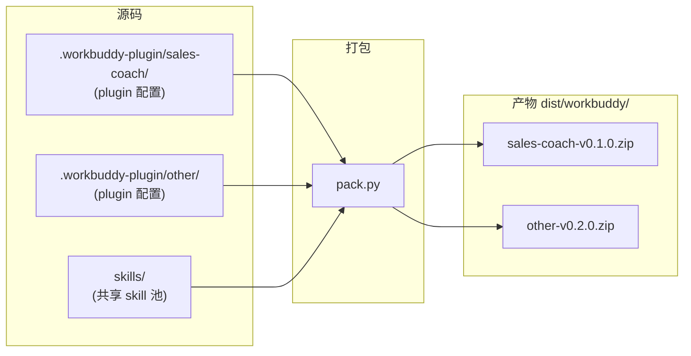
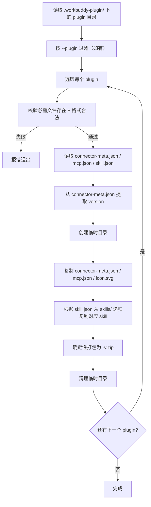

> ⚠️ **历史文档**：本文示例中的 `sales-coach` 已重命名为 `ai-customer`，`.workbuddy-plugin/` 架构已被 `bundles/` 取代。当前实现见 [RFC-0003](RFC-0003-skill-bundle-refactoring.md) + [RFC-0006](../approved/RFC-0006-skill-package-versioning-and-delivery.md)。

# RFC-0002：WorkBuddy 多 Plugin 打包体系

| 字段 | 值 |
|------|-----|
| 编号 | RFC-0002 |
| 状态 | Superseded |
| 替代 | RFC-0003 |
| 作者 | zoushen |
| 日期 | 2026-09-15 |
| 变体 | standard |
| 目标版本 | coachskills 多 plugin 打包首版 |

## 核心概览

> 阅读本节约 30 秒，可快速掌握本提案的核心逻辑。

**核心概要**：当前仓库整体作为一个 WorkBuddy 插件（coachskills），内含一个 MCP server 和一个 skill（`ai_customer_design`）。随着业务发展，需要支持"多个 plugin，每个 plugin 自由组合 skill + 绑定独立 MCP server"的模式。本提案在 `.workbuddy-plugin/` 下引入 per-plugin 配置目录，新建 `pack.py` 脚本从配置生成符合 WorkBuddy 规范的连接器 zip 包。

**重要开发共识**（grill-me 对齐结论蒸馏）：

- 每个 plugin = 一个 WorkBuddy 连接器，配置独立（connector-meta.json / mcp.json / icon.svg / skill.json）
- `skill.json` 用列表引用共享 `skills/` 目录中的 skill（按目录名匹配），多个 plugin 可复用相同 skill
- 产物只保留 zip，文件名含版本号（如 `sales-coach-v0.1.0.zip`），版本来自各 plugin 自己的 connector-meta.json
- 本轮只做 WorkBuddy，Codex 平台暂不考虑
- 新建 `pack.py`，独立于现有 `build.py`；现有维护脚本（`build.py` / `check.py` / `bump_version.py`）在本方案落地后标记废弃

**核心机制设计图**：



## 1. 背景与上下文

### 1.1 现状

RFC-0001 建立了"仓库即插件"的模式：整个 `coachskills` 仓库作为一个 WorkBuddy 连接器。当前仓库包含：

- 一个 skill：`ai_customer_design`（位于 `skills/ai_customer_design/`）
- 一个 MCP server 配置：`.mcp.json`（指向 enterprise-training 服务）
- 一份连接器元信息：`.workbuddy-plugin/connector-meta.json`（名称"公司培训技能"，版本 `0.1.0-rc.1`）
- 一个图标：`assets/icon.svg`

**维护脚本现状**：`build.py` / `check.py` / `bump_version.py` 三个脚本围绕"整仓一个 plugin"设计。其中 `build.py` 依赖 `.codex-plugin/plugin.json`（该文件实际不存在），当前已处于不可用状态。`check.py` 和 `bump_version.py` 仍可用于 WorkBuddy 单 plugin 场景。

### 1.2 痛点

随着业务发展，仓库将新增更多 skill，且这些 skill 需要搭配不同的 MCP server 组合成不同功能的 plugin。现有"整仓一个 plugin"的模式无法支持：

- **无法自由组合**：所有 skill 必须一起发布，不能按需拆分给不同 plugin
- **MCP 绑定单一**：整个仓库只能配一个 MCP server，无法让不同 plugin 连不同服务
- **配置冲突风险**：多个业务线的 skill 共用一份 connector-meta.json，版本和元信息互相干扰

### 1.3 触发时机

用户即将发布首个 plugin"深维智讯・销售陪练"（使用 `ai_customer_design` skill），且后续会有其他 plugin 搭配不同 MCP server。这是引入多 plugin 体系的合适时机——在第二个 plugin 出现前建立规则，避免迁移成本。

## 2. 目标与非目标

**目标**：

| ID | 要求 | 验收标准 |
|----|------|----------|
| G01 | 多 plugin 配置 | `.workbuddy-plugin/` 下可存在多个 plugin 目录，各自配置独立 |
| G02 | skill 自由组合 | 每个 plugin 通过 `skill.json` 声明包含哪些 skill |
| G03 | 独立 MCP 绑定 | 每个 plugin 有自己的 `mcp.json`，可连不同 MCP server |
| G04 | 快速打包 | 一条命令完成打包，输出带版本号的 zip |
| G05 | 产物统一管理 | zip 输出到统一目录，文件名含版本号防出错 |
| G06 | 文档可读 | 打包说明写在 `.workbuddy-plugin/README.md`，可直接查阅 |

**非目标**：

- 不处理 Codex 平台打包（暂不考虑）
- 不实现 plugin 间依赖解析
- 不引入 plugin 市场或注册中心
- 不改变 `skills/` 目录的现有结构

## 3. 决策与核心设计

> 设计本质：**每个 plugin 目录就是 WorkBuddy 连接器的源码视图**，打包脚本是"配置 + skill → 连接器 zip"的纯函数。

### 3.1 ADR-01：Plugin 配置目录结构

```text
.workbuddy-plugin/
├── sales-coach/                     # 第一个 plugin
│   ├── connector-meta.json          # 连接器元信息（WorkBuddy 规范字段）
│   ├── mcp.json                     # MCP server 配置（一个 connector 一个 server）
│   ├── icon.svg                     # 市场图标
│   └── skill.json                   # 声明包含哪些 skill
├── other-plugin/                    # 未来其他 plugin
│   ├── connector-meta.json
│   ├── mcp.json
│   ├── icon.svg
│   └── skill.json
└── README.md                        # 打包说明文档
```

**决策理由**：

- 目录名即 plugin 标识符，无需额外 ID 字段
- 每个文件直接对应 WorkBuddy 连接器规范中的必需文件
- `skill.json` 单独出来而非嵌入 connector-meta.json，因为 skill 选择是打包逻辑关注的，不是 WorkBuddy 运行时关注的

**connector-meta.json 格式**：直接遵循 WorkBuddy 连接器元信息规范。

首个 plugin 示例：

```json
{
  "name": "深维智讯・销售陪练",
  "name_zh": "深维智讯・销售陪练",
  "name_en": "Sales Coach",
  "description": "AI sales sparring and intelligent assessment.",
  "description_zh": "AI 销售陪练与智能评测，支持场景化角色扮演、实时对话练习与能力分析，帮助销售快速提升实战沟通能力。",
  "description_en": "AI sales sparring and intelligent assessment with scenario-based role play, real-time dialogue practice and capability analysis.",
  "source": "sales-coach",
  "type": "mcp",
  "version": "0.1.0",
  "minWorkbuddyVersion": "4.24.0",
  "examples_zh": ["创建一个销售沟通训练课程", "模拟客户进行角色扮演练习"],
  "examples_en": ["Create a sales conversation training course", "Practice role play with a simulated customer"]
}
```

> **关于 `source` 字段**：原 `connector-meta.json` 的 `source` 为 `"mgv-coachskills"`（RFC-0001 中定义为仓库标识）。多 plugin 模式下，`source` 改为 per-plugin 标识符（与目录名一致），用于 WorkBuddy 识别不同 connector。这是**有意变更**——每个 plugin 是独立 connector，应有独立 source。如果 WorkBuddy 依赖 `source` 做更新识别，同一 plugin 后续版本需保持 `source` 不变。

**mcp.json 格式**：遵循 WorkBuddy MCP 配置规范，每个 plugin 只配一个 MCP server。这是 WorkBuddy 运行时格式（含 `type` 字段），直接拷贝到 zip 产物中。

```json
{
  "mcpServers": {
    "enterprise-training": {
      "type": "streamableHttp",
      "url": "https://mcp.example.com/mcp"
    }
  }
}
```

> **注意**：这与仓库根 `.mcp.json` 的源格式不同（源格式只含 `url`，不含 `type`）。`.workbuddy-plugin/<plugin>/mcp.json` 直接存储运行时格式，pack.py 直接拷贝不做转换。

**skill.json 格式**：

```json
{
  "skills": ["ai_customer_design"]
}
```

**解析规则**：
- `skills` 数组中的每个值为 skill 目录名，对应 `skills/<name>/`
- 打包脚本递归复制整个 skill 目录（包括 `references/`、`scripts/`、`vendor/` 等所有子目录）
- 空数组表示该 plugin 不包含任何 skill（合法但少见）
- 重复条目去重处理
- skill 目录不存在时报错退出

### 3.2 ADR-02：打包脚本 pack.py

**脚本职责**：读取 `.workbuddy-plugin/<plugin>/` 配置，组装 WorkBuddy 连接器结构，打包为 zip。

**命令行接口**：

```bash
# 打包所有 plugin
python3 scripts/pack.py

# 只打包指定 plugin（支持多次指定）
python3 scripts/pack.py --plugin sales-coach
python3 scripts/pack.py --plugin sales-coach --plugin other

# 指定输出目录（默认 dist/workbuddy）
python3 scripts/pack.py --out dist/workbuddy
```

**打包流程**：



**校验步骤**（pack.py 内置）：
- connector-meta.json：必需字段存在（name / version / type / source），JSON 格式合法
- mcp.json：有且仅有一个 server，URL 为 HTTPS，JSON 格式合法
- icon.svg：文件存在且非空
- skill.json：skills 数组中每个目录在 `skills/` 下存在
- version：符合 semver 格式

**确定性构建约束**（对齐 RFC-0001 §3.10 标准）：
- ZIP 条目按文件名排序
- 固定时间戳（1980-01-01 00:00:00）
- 固定文件权限（0o644）
- 相同输入产出相同 sha256

**产物结构**：

```text
dist/workbuddy/
├── sales-coach-v0.1.0.zip           # 文件名 = plugin名-v版本号.zip
└── other-plugin-v0.2.0.zip
```

**zip 内部结构**（符合 WorkBuddy 连接器规范）：

```text
sales-coach-v0.1.0.zip               # 根即包内容，不套版本目录
├── connector-meta.json
├── mcp.json
├── icon.svg
└── skills/
    └── ai_customer_design/
        ├── SKILL.md
        ├── references/
        │   ├── course-workflows.md
        │   ├── file-upload.md
        │   ├── result-and-progress.md
        │   └── troubleshooting.md
        ├── scripts/
        │   └── render_qr.py
        └── vendor/
            └── segno/
                └── ...
```

> skill 目录**递归全量复制**，包括 `references/`、`scripts/`、`vendor/` 等所有子目录和文件。`__pycache__/` 和 `.pyc` 文件排除。

### 3.3 ADR-03：版本来源

每个 plugin 独立版本，来源于其 `connector-meta.json` 的 `version` 字段。不再有全局版本同步机制。

**理由**：不同 plugin 发布节奏不同，独立版本避免互相阻塞。

### 3.4 ADR-04：现有维护脚本处置

| 脚本 | 处置 | 理由 |
|------|------|------|
| `build.py` | 标记废弃，本方案落地后删除 | 已不可用（缺少 `.codex-plugin/plugin.json`），且与新架构不兼容 |
| `check.py` | 保留，调整检查范围 | 通用化基线检查（frontmatter / host-terms / references）仍适用于 skills/ |
| `bump_version.py` | 标记废弃，本方案落地后删除 | 多 plugin 独立版本，不再需要全局同步 |
| `.gitlab-ci.yml` | 更新 CI 配置 | release stage 从 `build.py` 切换到 `pack.py` |

**迁移时序**：
1. 先编写 `pack.py` 并通过测试
2. 创建首个 plugin 目录（`sales-coach/`），迁移配置
3. 删除旧文件（`.workbuddy-plugin/connector-meta.json`、`.codex-plugin/`、`build.py`、`bump_version.py`）
4. 更新 `.gitlab-ci.yml` 的 release stage
5. 更新 `check.py` 的检查范围（如有影响）

### 3.5 复用既有模块

| 复用 | 说明 |
|------|------|
| `skills/` 目录 | skill 源码不变，pack.py 按名引用并递归复制 |
| WorkBuddy 连接器规范 | connector-meta.json / mcp.json 格式直接采用 |
| `assets/icon.svg` | 迁移到首个 plugin 目录 |
| `.mcp.json`（根） | 内容迁移到首个 plugin 的 mcp.json |

| 新增 | 说明 |
|------|------|
| `.workbuddy-plugin/<plugin>/` | per-plugin 配置目录 |
| `scripts/pack.py` | 打包脚本 |
| `.workbuddy-plugin/README.md` | 打包说明文档 |

## 4. 备选方案与权衡

| 选项 | 优点 | 缺点 |
|------|------|------|
| A：per-plugin 目录（选定） | 配置自包含，一目了然；每个文件对应 WorkBuddy 规范 | 目录数随 plugin 增长 |
| B：单配置文件定义所有 plugin | 文件少，全局视角 | 多人编辑易冲突；文件越来越大；不符合"plugin 独立"的心智模型 |
| C：扩展现有 build.py | 复用已有代码 | build.py 设计假设"整仓一个 plugin"，改造成本高且容易引入回归；与 Codex 逻辑耦合 |

**选定与否决理由**：

- **选 A**：per-plugin 目录最贴合"每个 plugin 是独立连接器"的心智模型，配置文件与 WorkBuddy 运行时结构一一对应，减少转换逻辑
- **否决 B**：单配置文件看似简单，但当 plugin 数量增长后会变成热点文件，且违背"plugin 配置和 plugin 名称绑定"的用户需求
- **否决 C**：build.py 已不可用（缺少 `.codex-plugin/plugin.json`），且其 Git 快照、双平台、release 门禁等逻辑与新需求无关

## 5. 结果与影响

- **正面**：
  - 支持 skill 自由组合，不同业务线可按需发布独立 plugin
  - 每个 plugin 独立版本、独立 MCP，互不干扰
  - 打包过程简单直接，一条命令完成
  - 新增 plugin 只需新建目录 + 配置文件

- **负面**：
  - 维护多份 connector-meta.json（但每份更小更聚焦）
  - 不再有一个"仓库总版本"的概念（这是有意的取舍——不同 plugin 发布节奏不同）
  - 需要删除 `build.py` / `bump_version.py` 并更新 CI（一次性迁移成本）

- **中性 / 后续动作**：
  - 如果未来需要 Codex 多 plugin 支持，需要另行设计
  - 旧版 `coachskills-0.1.0-rc.1-workbuddy.zip` 与新命名格式不兼容，需要 WorkBuddy 端作为新 connector 提交

## 6. 实施计划

| 阶段 | 内容 | 风险 | 预估工期 |
|------|------|------|----------|
| P1 | 编写 `scripts/pack.py`（含校验 + 确定性构建） | 中：需确保 zip 结构符合 WorkBuddy 规范 | 1-2 天 |
| P2 | 创建 `.workbuddy-plugin/sales-coach/` 目录，从现有文件迁移配置 | 低：文件移动 + 格式调整 | 半天 |
| P3 | 编写 `.workbuddy-plugin/README.md` | 低 | 半天 |
| P4 | 删除旧文件（`build.py` / `bump_version.py` / 旧 `connector-meta.json`） | 低 | 半天 |
| P5 | 更新 `.gitlab-ci.yml` 和 `check.py` | 中：需要测试 CI 流水线 | 半天 |
| P6 | 验证：打包 → 检查 zip 内容 → 确认可安装 | 中：需要 WorkBuddy 环境验证 | 1 天 |

## 7. 测试计划

| 测试项 | 验证方法 |
|--------|----------|
| 单 plugin 打包 | `python3 scripts/pack.py --plugin sales-coach`，检查 zip 内容完整性 |
| 多 plugin 打包 | 创建两个 plugin 目录，`python3 scripts/pack.py`，检查两个 zip |
| 版本号正确 | connector-meta.json 设不同版本，检查 zip 文件名包含正确版本 |
| skill 全量复制 | skill.json 引用的 skill 含 `references/` / `scripts/` / `vendor/`，检查 zip 内完整 |
| 确定性构建 | 同一配置打包两次，对比 zip 的 sha256 应一致 |
| skill 不存在时报错 | skill.json 引用不存在的 skill，脚本应报错退出 |
| connector-meta.json 缺失时报错 | 删除必需文件，脚本应报错退出 |
| icon.svg 缺失时报错 | 删除 icon.svg，脚本应报错退出 |
| mcp.json 格式错误时报错 | 写入非法 JSON，脚本应报错退出 |
| mcp.json 多 server 时报错 | 配置两个 server，脚本应报错退出 |
| version 非 semver 时报错 | 写入非法版本号，脚本应报错退出 |
| --plugin 不存在时报错 | 指定不存在的 plugin 名，脚本应报错退出 |
| 输出目录已有旧 zip | 重复打包，新 zip 覆盖旧 zip |

## 8. 开放问题与风险

- **O1**：`source` 字段变更后，WorkBuddy 是否可正常注册新 source？需业务负责人在正式提交前确认（继承 RFC-0001 §8 的未决项）
- **O2**：`minWorkbuddyVersion: 4.24.0` 是文档基线，非已验证的产品支持下限（继承 RFC-0001 的标注）
- **O3**：如果多个 plugin 需要共享同一个 icon.svg，是否需要支持符号链接或全局默认？首期不支持，每个 plugin 各自存放

## 9. 时间线

| 里程碑 | 内容 | 预计时间 |
|--------|------|----------|
| M1 | pack.py 初版完成，单 plugin 打包可用 | 实施后第 2 天 |
| M2 | 多 plugin 打包 + 完整错误处理 + 测试 | 实施后第 3 天 |
| M3 | README.md + 配置迁移 + 旧脚本清理 | 实施后第 4 天 |
| M4 | CI 更新 + 端到端验证（打包 → WorkBuddy 安装） | 实施后第 5 天 |
