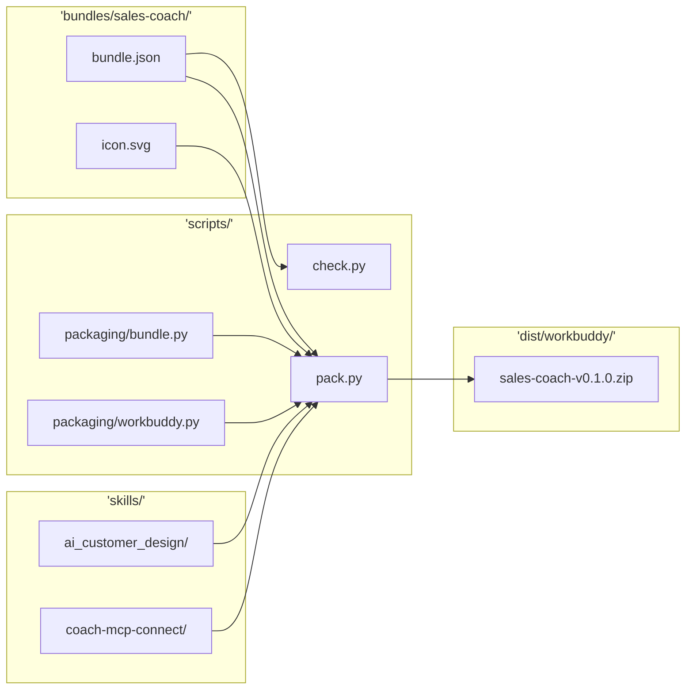
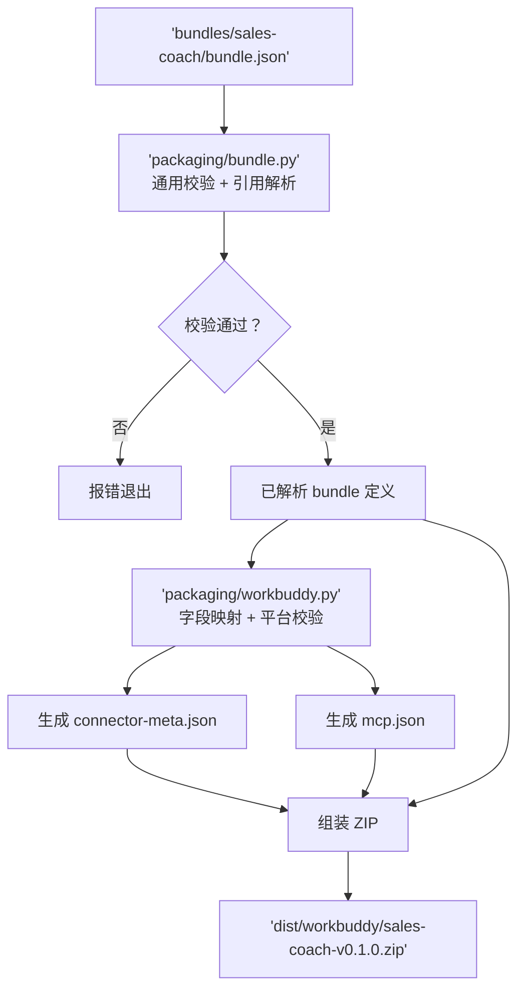

# RFC-0003：技能包 Bundle 化重构

| 字段 | 值 |
|------|-----|
| 编号 | RFC-0003 |
| 状态 | Draft |
| 作者 | zoushen |
| 日期 | 2026-09-15 |
| 变体 | standard |
| 目标版本 | coachskills bundle 化首版 |
| 替代 | RFC-0002（superseded） |

## 核心概览

> 阅读本节约 30 秒，可快速掌握本提案的核心逻辑。

**核心概要**：当前仓库的技能包配置混合了三层信息——通用组合定义（技能列表、版本）、展示资源（多语言文案、图标）和平台适配字段（`minWorkbuddyVersion`、连接器 `type`、`source`）——散落在 `.workbuddy-plugin/sales-coach/` 下的四个文件中。修改一个功能需要在多个文件间跳转，且通用概念与 WorkBuddy 平台概念交织，无法复用到其他发布渠道。本提案引入 `bundles/` 目录作为独立于平台的发布单元，将技能组合提升为 `bundle.json` 的通用定义，平台原生文件（`connector-meta.json`、`mcp.json`）全部由构建生成。

**重要开发共识**（grill-me 对齐结论蒸馏）：

- 三层结构：Skill 是能力，Bundle 是交付组合，Target 是平台格式
- 一个 bundle 的所有信息集中在一份 `bundle.json`，平台独有字段放 `targets.<platform>` 内
- `bundle.json` 的 `mcp` 是全仓唯一连接配置权威来源，删除根目录 `.mcp.json`
- 平台原生文件（`connector-meta.json`、`mcp.json`）由构建生成，不手工维护
- `coach-mcp-connect` 继续保留在 sales-coach 的 `skills` 列表，暂不独立为共享技能
- 版本一套：bundle 定义版本，各平台产物继承，不维护平台级版本状态
- 本 RFC supersede RFC-0002，迁移完成后 `.workbuddy-plugin/` 退出手工维护

**核心机制设计图**：



## 1. 背景与上下文

促成本决策的"力"：

- **配置混合三层信息**。当前 `.workbuddy-plugin/sales-coach/` 下有四个文件：`pack_config.json`（版本 + 技能列表）、`connector-meta.json`（名称、描述、多语言文案、`minWorkbuddyVersion`、`type`、`source`）、`mcp.json`（MCP 连接）、`icon.svg`（图标）。其中 `connector-meta.json` 一个文件就混合了通用展示信息（`name_zh`、`description_en`、`examples`）和 WorkBuddy 平台字段（`type: "mcp"`、`source`、`minWorkbuddyVersion`）。维护者修改一个功能需要在多个文件间跳转，无法直觉判断"应该改哪个文件"
- **通用概念与平台概念耦合**。`pack_config.json` 描述"销售陪练包含哪些能力、发布什么版本"，这是产品组合定义，不属于任何特定平台。但它被放在 `.workbuddy-plugin/` 下，意味着"我的产品是什么"和"我要发布到哪里"混在一起。未来增加发布渠道时，无法复用同一份组合定义
- **根目录存在冗余配置**。根目录 `.mcp.json`（供 IDE 开发环境使用）与 `.workbuddy-plugin/sales-coach/mcp.json`（供 WorkBuddy 运行时使用）几乎相同，仅差一个 `type: "streamableHttp"` 字段。修改 MCP 地址需要同步两处
- **构建与校验职责耦合**。`pack.py`（约 240 行）同时承担"读取组合配置"和"生成 WorkBuddy 格式 ZIP"两个职责。`check.py`（约 300 行）的 `manifests` 检查直接读取 WorkBuddy 插件目录结构。两者都与 `.workbuddy-plugin/` 紧耦合
- **已有先例 RFC 铺垫**。RFC-0002 建立了多 Plugin 打包体系，但其设计以 WorkBuddy 为中心。本次重构是 RFC-0002 的自然演进——将"产品组合"概念从平台绑定中释放出来

## 2. 目标与非目标

**目标**：

- 一个技能包的所有通用定义（组合、版本、展示、连接）集中在一份 `bundle.json`，维护时只需查看一个目录
- 平台原生文件（`connector-meta.json`、`mcp.json`）由构建从 `bundle.json` 生成，源码不手工维护
- 增加发布平台时复用同一份 `bundle.json`，只需增加对应的平台适配模块
- 删除根目录 `.mcp.json` 和 `assets/icon.svg`（旧版本），消除冗余配置源
- `check.py` 和 `pack.py` 共享通用校验逻辑，各自独立执行平台校验
- 迁移后的 ZIP 产物与迁移前完全一致（条目、内容、排序、时间戳不变）

**非目标**：

- 不引入共享连接注册表（`connections/`）——当前只有一个 bundle，等真正需要跨 bundle 共享时再提取
- 不引入平台级 `include/exclude` 技能过滤——技能组合只有一个权威来源
- 不实现多版本体系——bundle 定义版本，平台产物继承，平台状态另行记录
- 不实现 Codex 或其他新平台的适配——本次只做 WorkBuddy，但结构上为未来平台留好扩展点
- 不改变 `skills/` 目录内部结构——技能本身的组织方式不变
- 不改变 `file_validator.py` 的文件边界校验逻辑——直接复用

## 3. 决策与核心设计

> 设计本质：将"产品是什么"（bundle）与"产品怎么分发"（target）解耦，使组合定义独立于任何平台，平台适配成为构建时的单向转换。

### 3.1 目录结构

```text
coachskills/
├── skills/
│   ├── ai_customer_design/
│   └── coach-mcp-connect/
│
├── bundles/
│   └── sales-coach/
│       ├── bundle.json
│       └── icon.svg
│
├── scripts/
│   ├── check.py
│   ├── pack.py
│   ├── file_validator.py          # 复用既有，不修改
│   └── packaging/
│       ├── __init__.py            # 空文件，使 packaging 成为常规包
│       ├── bundle.py              # 配置读取、引用解析、通用校验、write_zip
│       └── workbuddy.py           # WorkBuddy 字段映射、平台校验
│
├── tests/
│   ├── test_check.py
│   ├── test_pack.py
│   └── test_bundle.py             # 新增：bundle.json schema 校验
│
├── docs/
└── dist/
    └── workbuddy/
        └── sales-coach-v0.1.0.zip
```

删除的目录和文件：

- `.workbuddy-plugin/`（整个目录，含 `sales-coach/connector-meta.json`、`mcp.json`、`pack_config.json`、`icon.svg`、`README.md`）
- `.mcp.json`（根目录）
- `assets/icon.svg`（旧版本图标）

`assets/` 目录本身保留（其中 `GitHub项目主页封面横幅设计.jpeg` 是项目级资源，与 bundle 无关）。

### 3.2 bundle.json Schema

```json
{
  "schemaVersion": 1,
  "id": "sales-coach",
  "version": "0.1.0",
  "skills": [
    "ai_customer_design",
    "coach-mcp-connect"
  ],
  "presentation": {
    "defaultLocale": "zh-CN",
    "locales": {
      "zh-CN": {
        "name": "深维智讯・销售陪练",
        "description": "AI 销售陪练与智能评测。",
        "examples": [
          "创建一个销售沟通训练课程"
        ]
      },
      "en": {
        "name": "Sales Coach",
        "description": "AI sales practice and assessment.",
        "examples": [
          "Create a sales training course"
        ]
      }
    },
    "icon": "icon.svg"
  },
  "mcp": {
    "servers": {
      "enterprise-training": {
        "transport": "streamable-http",
        "url": "https://mcp.test.omnimay.com/coach/mcp"
      }
    }
  },
  "targets": {
    "workbuddy": {
      "source": "sales-coach",
      "type": "mcp",
      "minVersion": "4.24.0"
    }
  }
}
```

各字段职责：

- `schemaVersion`：`bundle.json` 自身的 schema 版本，用于未来格式演进时向后兼容
- `id`：bundle 在仓库内的稳定身份，同时作为 ZIP 文件名的基础
- `version`：这组交付内容的 SemVer 版本号，各平台产物继承
- `skills`：引用的 `skills/` 目录下的技能名列表，只声明组合不包含平台概念
- `presentation`：展示资源，包含多语言文案和图标引用。`defaultLocale` 决定生成平台文件时哪个语言映射到 `name`（无后缀字段）
- `mcp.servers`：MCP 连接定义，通用格式（`transport` + `url`），具体字段拼写由平台适配层转换
- `targets`：平台独有信息。`targets.workbuddy` 包含 WorkBuddy 渠道身份（`source`）、连接器类型（`type`）和最低宿主版本（`minVersion`）

**设计取舍**：`source` 虽然当前与 `id` 相同，仍显式保留为平台字段。这避免未来调整内部命名（`id`）时意外改变渠道身份（`source`），代价是多写一行配置。

### 3.3 构建流水线



构建步骤：

- **Step 1 — 通用校验**（`bundle.py`）：`load_bundle()` 读取并解析 `bundle.json` 为 dict；`validate_bundle()` 校验 schema（必填字段、类型、semver 格式）；`resolve_skills()` 确认每个 skill 目录存在且通过 `file_validator.check_skill_files`；校验 `presentation.icon` 引用的文件存在且非空。`check.py` 也调用 `load_bundle()` 获取同一解析结果，传递给平台校验
- **Step 2 — 平台转换**（`workbuddy.py`）：`generate_connector_meta(bundle)` 和 `generate_mcp_json(bundle)` 接收已解析的 bundle dict，**返回 dict（不写入磁盘）**；`pack.py` 将 dict 序列化为 JSON bytes 后传给 `write_zip`。`validate_workbuddy(bundle)` 执行平台约束校验（恰好一个 MCP server、HTTPS URL、`minVersion` 格式）
- **Step 3 — 组装 ZIP**（`bundle.py` 的 `write_zip`）：复用既有确定性 ZIP 写入逻辑（排序 + `ZIP_EPOCH` + `0o644` 权限 + 原子写入），条目包含 `connector-meta.json`、`mcp.json`、`icon.svg`、`skills/<name>/**`。生成的 JSON 使用 `json.dumps(data, ensure_ascii=False, indent=2, sort_keys=True)`——**注意 `sort_keys=True` 是新增行为**（当前 `pack.py` 未使用），确保 key 排序稳定。阶段 3 对比时需确认旧版手工 JSON 的 key 顺序与 `sort_keys=True` 字母序的差异，必要时调整映射代码的 key 插入顺序或在对比阶段使用 `jq -S` 语义对比

CLI 接口演进：

```bash
python3 scripts/check.py                                # 全量（通用 + WorkBuddy 校验）
python3 scripts/pack.py --bundle sales-coach --target workbuddy  # 指定 bundle 和目标平台
python3 scripts/pack.py --target workbuddy                # 打包所有 bundle 到 WorkBuddy
```

### 3.4 WorkBuddy 字段映射

从 `bundle.json` 到 WorkBuddy 原生文件的字段映射采用**显式一对一映射**，不使用 JSON 深度合并，防止平台配置悄悄覆盖通用定义。所有映射函数集中在 `workbuddy.py` 内一个 `_locale_field()` helper 中处理"如存在"逻辑，避免散落到各字段映射中。

**Locale 边界规则**：

- `defaultLocale` 对应的 locale 条目必须存在于 `presentation.locales` 中，否则校验报错：`bundle.json 校验失败：defaultLocale 'xx' 对应的 locale 条目缺失`
- 非 `defaultLocale` 的语言后缀字段（`name_zh`、`name_en` 等）仅在该 locale 存在时生成；不存在时**直接省略**，不从 `defaultLocale` 填充。例如 `defaultLocale: "zh-CN"` 且 `locales` 中无 `en`，则生成的 `connector-meta.json` 不含 `name_en`/`description_en`/`examples_en`
- `examples` 字段在 locale 中为空数组时，生成的后缀字段同样为空数组（`"examples_zh": []`），不省略
- `name`（无后缀）始终映射自 `defaultLocale` 对应的 locale

**设计取舍**：`presentation.locales` 嵌套结构相比原有 `name_zh`/`name_en` 平铺增加了编辑复杂度（多一层缩进）。选择嵌套结构的原因是：对齐 Tauri/VS Code 的 i18n 模式，第三语言出现时只需在 `locales` 中增加一个 key，无需修改 schema 或映射代码。

`connector-meta.json` 生成规则：

| bundle.json 字段 | connector-meta.json 字段 | 说明 |
|---|---|---|
| `presentation.locales[defaultLocale].name` | `name` | 默认语言名称 |
| `presentation.locales["zh-CN"].name` | `name_zh` | 中文名称（如存在） |
| `presentation.locales["en"].name` | `name_en` | 英文名称（如存在） |
| `presentation.locales[defaultLocale].description` | `description` | 默认语言描述 |
| `presentation.locales["zh-CN"].description` | `description_zh` | 中文描述（如存在） |
| `presentation.locales["en"].description` | `description_en` | 英文描述（如存在） |
| `presentation.locales["zh-CN"].examples` | `examples_zh` | 中文示例（如存在） |
| `presentation.locales["en"].examples` | `examples_en` | 英文示例（如存在） |
| `targets.workbuddy.type` | `type` | 连接器类型，固定 `"mcp"` |
| `targets.workbuddy.source` | `source` | 渠道身份 |
| `targets.workbuddy.minVersion` | `minWorkbuddyVersion` | 最低宿主版本 |
| `version`（bundle 级） | `version` | 构建时注入（与 RFC-0002 行为一致） |

`mcp.json` 生成规则：

| bundle.json 字段 | mcp.json 字段 | 说明 |
|---|---|---|
| `mcp.servers.<key>.url` | `mcpServers.<key>.url` | 直接映射 |
| `mcp.servers.<key>.transport` | `mcpServers.<key>.type` | `"streamable-http"` → `"streamableHttp"` |

`icon.svg`：从 `bundles/sales-coach/icon.svg` 直接复制到 ZIP 根目录。

### 3.5 校验职责拆分

`check.py` 同时执行两层校验，开发者一次 `python3 scripts/check.py` 发现所有问题：

- **通用层**（`bundle.py` 提供）：`bundle.json` schema 完整性、skills 目录存在性、文件边界安全、icon 引用有效、semver 格式
- **平台层**（`workbuddy.py` 提供）：恰好一个 MCP server、HTTPS URL 约束、`minVersion` 格式合法性

`check.py` 的 `manifests` 检查从读取 `.workbuddy-plugin/` 改为读取 `bundles/`。新实现概要：`check_manifests(full)` 遍历 `bundles/*/bundle.json`，对每个 bundle 调用 `bundle.load_bundle()` + `bundle.validate_bundle()` + `workbuddy.validate_workbuddy()`，`full` 参数语义不变（全量模式下 bundle 目录缺失时报错，`--only` 模式下静默跳过）。新增的 bundle 校验错误沿用现有 `E-MAINT-MANIFESTS` category，不引入新 category。其他检查项（`frontmatter`、`host-terms`、`trigger-phrases`、`mechanism-terms`、`references`、`readme`、`migration`、`qr-fallback`、`oauth-copy`、`file-boundary`）保持不变，它们操作的是 `skills/` 目录，与 bundle 结构无关。

### 3.6 复用既有模块

| 模块 | 复用方式 | 变更 |
|---|---|---|
| `file_validator.py` | 直接复用，不修改 | 无 |
| `pack.py` 的 `write_zip` | 迁移到 `packaging/bundle.py`，`pack.py` 调用 `bundle.write_zip()` | 提取为共享函数 |
| `pack.py` 的 `ZIP_EPOCH`、确定性写入逻辑 | 迁移到 `packaging/bundle.py` | 与 `write_zip` 一同迁移 |
| `pack.py` 的 `SEMVER_RE` | 迁移到 `packaging/bundle.py` 并导出 | `check.py` 删除重复定义，改为从 `bundle.py` 导入 |
| `check.py` 的非 manifest 检查 | 保留不变 | 仅 `check_manifests` 函数改为读取 `bundle.json` |

### 3.7 行业先例

本方案的"通用配置 + 平台适配"模式与多个成熟项目的设计一致：

- **Tauri**：`tauri.conf.json` 定义通用配置，`bundle.linux`/`bundle.macOS`/`bundle.windows` 子节点存放平台参数，支持 `tauri.{os}.conf.json` 覆盖文件通过 JSON Merge Patch（RFC 7396）合并。一个配置源 → 七种输出格式（deb/rpm/appimage/msi/nsis/app/dmg），每种格式一个独立 bundler 模块，共享 `Settings` 结构体
- **VS Code (vsce)**：`package.json` 作为通用清单，`vsce package --target <platform>` 从同一源生成平台特定 VSIX。`extensionKind` 声明执行位置，`main`/`browser` 字段分支入口点
- **Turborepo / Nx**：`turbo.json`/`project.json` 声明任务图，通过 `inputs`/`outputs`/`dependsOn` 微语法控制构建依赖和缓存，per-package 配置可 override workspace 级配置
- **Unplugin (unjs)**：最直接的"写一次，适配多平台"先例——定义一套插件接口，运行时转换为 Vite/Rollup/Webpack/esbuild 等 10+ 打包器的原生格式。核心模式与本方案一致：通用定义 → 平台适配层 → 原生输出

本方案的核心思路——`bundle.json` 作为通用定义、`targets` 存放平台差异、构建时单向转换为平台原生格式——与上述项目的模式一致，只是规模小得多（1 个 bundle、1 个目标平台）。

## 4. 备选方案与权衡

| 选项 | 优点 | 缺点 |
|------|------|------|
| A：维持现状（`.workbuddy-plugin/` 四文件） | 零改动成本 | 三层信息继续混合；增加平台需要复制整套文件；修改 MCP 地址需同步两处 |
| B：仅将 `pack_config.json` 搬到仓库根目录 | 改动最少，`pack_config.json` 脱离平台目录 | `connector-meta.json` 和 `mcp.json` 仍散落在 `.workbuddy-plugin/`；通用概念与平台概念仍交织；只解决一半问题 |
| **C：`bundles/<name>/bundle.json`，平台字段内联在 `targets`** | 一个组合集中维护；通用与平台职责清楚；结构对齐行业先例 | 需要调整构建器和校验器（约 3 天工作量） |
| D：bundle 定义与 `targets/*.json` 分文件 | 多平台配置可独立维护 | 当前只有一个目标平台，文件碎片化增加跳转成本；等平台配置明显增长后再拆不迟 |

**选定与否决理由**：

- 选 **C**：在"集中度"和"碎片化"之间取最佳平衡点。一份 `bundle.json` 足够容纳当前规模（1 个 bundle、1 个平台），同时 `targets` 子结构为未来多平台预留扩展位。Tauri 和 VS Code 验证了这种"通用定义 + 平台子节点"的模式在大规模项目中的可行性
- 否决 B：只解决部分问题，且引入"配置文件散落在两个位置"的新复杂度
- 否决 D：当前只有一个平台，拆成多文件是过早抽象。当平台配置增长到需要独立维护时（通常 3+ 平台），再拆分为时不晚

## 5. 结果与影响

- **正面**：维护销售陪练时只需查看 `bundles/sales-coach/` 一个目录；修改 MCP 地址只改一处（`bundle.json`）；新增发布平台只需增加 `packaging/<platform>.py` 适配模块，不触及通用配置；消除根目录 `.mcp.json` 和 `assets/icon.svg` 的冗余；ZIP 产物与迁移前完全一致，对用户无感
- **负面**：需要一次性迁移工作（约 3 天）；构建器复杂度从单文件（约 240 行 `pack.py`）变为两文件模块（`bundle.py` + `workbuddy.py`），新人需要理解两层转换；`bundle.json` 的 `presentation.locales` 结构比原来的 `name_zh`/`name_en` 平铺字段更嵌套，手工编辑时多一层缩进
- **中性 / 后续动作**：当出现第二个 bundle 且共享同一 MCP 服务时，需评估是否引入 `connections/` 共享注册表；当出现第二个发布平台时，需评估 `--target` 过滤是否应下推到 `check.py`；RFC-0002 需标记为 superseded。RFC-0001 提到的 Codex 路径（`.codex-plugin/`）当前未实现，本 RFC 不影响该路径；根 `.mcp.json` 的删除仅影响 IDE 开发体验，开发者需自行在本地创建 `.mcp.json` 或改用 `bundle.json` 中的配置。若 6 个月内未出现第二个 bundle 或第二个发布平台，应评估本方案的结构预留是否过度，必要时回退为扁平配置

## 6. 实施计划

### 阶段 1：创建 bundle 结构并迁移配置

- 创建 `bundles/sales-coach/` 目录
- 从 `.workbuddy-plugin/sales-coach/` 四个文件提取内容，合并为 `bundle.json`。旧 `connector-meta.json` 不含 `version` 字段（由 pack.py 构建时注入），版本统一从 `bundle.json` 的 `version` 字段获取
- 将 `.workbuddy-plugin/sales-coach/icon.svg` 复制到 `bundles/sales-coach/icon.svg`
- 删除 `.mcp.json`（根目录）和 `assets/icon.svg`（旧版本）

### 阶段 2：拆分构建模块

- 创建 `scripts/packaging/` 目录，含空 `__init__.py`（使 packaging 成为常规包，避免 namespace package 的 import 脆弱性）
- 实现 `bundle.py`：`load_bundle()`、`validate_bundle()`、`resolve_skills()`、`write_zip()`（从 `pack.py` 迁入）、`SEMVER_RE`（供 `check.py` 导入）
- 实现 `workbuddy.py`：`generate_connector_meta()`、`generate_mcp_json()`（均返回 dict，不写磁盘）、`validate_workbuddy()`、`_locale_field()` helper
- 重构 `pack.py`：调用 `bundle.py` + `workbuddy.py`，CLI 改为 `--bundle` + `--target`。保持向后兼容：无 `--bundle` 时打包所有 bundle，`--target` 默认 `workbuddy`
- 重构 `check.py`：`check_manifests` 改为调用 `bundle.load_bundle()` + `workbuddy.validate_workbuddy()`；删除 `SEMVER_RE` 重复定义，改为从 `bundle.py` 导入

### 阶段 3：对比验证

- 使用旧 `pack.py`（git stash 或分支）和新 `pack.py` 分别打包
- **先语义对比再字节对比**：对 `connector-meta.json` 和 `mcp.json`，先用 `jq -S .` 排序 key 后做语义对比（确保字段名和值一致），再做字节对比（确保 JSON 序列化格式一致）。生成的 JSON 使用 `sort_keys=True` 确保 key 顺序稳定，与旧版手工 JSON 的 key 顺序对齐
- 逐文件对比 ZIP 条目：`icon.svg` 字节一致、`skills/` 下文件列表和内容一致
- 确认 ZIP 元数据一致：排序、时间戳（`ZIP_EPOCH`）、权限（`0o644`）

### 阶段 4：清理与文档更新

- 删除 `.workbuddy-plugin/` 整个目录
- 更新 `tests/test_pack.py`：现有 fixture `plugin_repo` 创建 `.workbuddy-plugin/test-plugin/` 下 4 个文件，需重写为创建 `bundles/test-bundle/bundle.json` + `icon.svg`。错误处理测试的触发条件从"文件缺失"变为"bundle.json 字段缺失/格式错误"。多 plugin 测试变为多 bundle 测试
- 新增 `tests/test_bundle.py`：覆盖 bundle.json schema 校验（必填字段缺失、semver 非法、skill 目录不存在、icon 缺失、locale 边界规则）
- 新增 `tests/test_check.py` 的 `manifests` 检查测试用例（当前无覆盖），覆盖 bundle 目录不存在、bundle.json 格式错误等场景
- 报错信息统一格式：`bundle.json 校验失败：<具体原因>`（如 `缺少必填字段 'version'`、`'version' 不是合法 semver：'abc'`、`defaultLocale 'xx' 对应的 locale 条目缺失`）
- 更新 `README.md`，具体变更点：
  - 项目结构目录树：`.workbuddy-plugin/` 段（约第 23-28 行）改为 `bundles/sales-coach/`（含 `bundle.json` + `icon.svg`）
  - 删除 `.workbuddy-plugin/sales-coach/icon.svg` 行
  - 删除 `assets/icon.svg` 引用（约第 44 行）
  - `scripts/` 段新增 `packaging/` 子目录说明
  - "市场图标"说明（约第 113 行）更新为 `bundles/sales-coach/icon.svg`
- 更新 `docs/releasing.md`：命令模板从 `--plugin` 改为 `--bundle`，参数名 `--plugin NAME` → `--bundle NAME`，输出路径说明不变
- 更新 `.gitlab-ci.yml`：

```yaml
# 变更前（当前）
script: python3 scripts/pack.py --out dist/workbuddy

# 变更后
script: python3 scripts/pack.py --bundle sales-coach --target workbuddy --out dist/workbuddy
```

- 将 `.workbuddy-plugin/README.md` 中的打包规则（`__pycache__`/`.pyc` 排除、ZIP 内部结构、校验规则列表）迁移到 `bundles/README.md` 或项目根 `README.md` 的构建章节
- 将 RFC-0002 frontmatter 标记 `status: Superseded`，添加 `superseded_by: RFC-0003`

### 回滚方案

每个阶段完成后运行对比验证（阶段 3 的 ZIP 对比）。如果新构建产物与旧构建不一致，回退到前一阶段。阶段 1-2 可在分支上完成，阶段 3 验证通过后再合并。

## 7. 测试计划

### 单元测试

- `test_bundle.py`：验证 `bundle.json` schema 校验——必填字段缺失报错（`bundle.json 校验失败：缺少必填字段 'version'`）、semver 格式非法报错、skill 目录不存在报错、icon 文件缺失报错、`presentation.locales` 结构校验（`defaultLocale` 对应条目必须存在、非 defaultLocale 缺失时后缀字段省略）
- `test_workbuddy.py`：验证字段映射——`presentation.locales.zh-CN.name` → `name_zh`、`transport` → `type` 转换、`minVersion` → `minWorkbuddyVersion` 映射、恰好一个 MCP server 校验、非 HTTPS URL 报错、locale 缺失时后缀字段正确省略
- `test_pack.py`：fixture 从 `plugin_repo`（创建 `.workbuddy-plugin/` 下 4 文件）重写为 `bundle_repo`（创建 `bundles/` 下 `bundle.json` + `icon.svg`）；错误处理测试触发条件从"文件缺失"变为"bundle.json 字段缺失/格式错误"；验证 ZIP 条目与迁移前一致；保持确定性 ZIP 测试（排序、时间戳、权限）

### 集成测试

- 端到端打包测试：从 `bundle.json` 到 ZIP，对比迁移前后产物字节一致性
- `check.py` 全量运行：确认所有检查项在新结构下正常工作

### 验收标准

- `python3 scripts/check.py` 通过，exit 0
- `python3 scripts/pack.py --bundle sales-coach --target workbuddy` 成功生成 ZIP
- 新 ZIP 与 `dist/workbuddy/sales-coach-v0.1.0.zip`（迁移前版本）逐文件对比一致
- 现有 `tests/test_check.py` 和 `tests/test_pack.py` 全部通过（更新后）

## 8. 开放问题与风险

- `check.py` 是否应支持 `--target workbuddy` 过滤以只运行特定平台的校验？当前方案是默认全量运行，等平台数量 ≥ 2 时再加过滤。如果第一个新平台到来时 check 变慢，需补上此功能
- `bundle.json` 的 `mcp.servers` 是否应支持环境变量引用（如 `$MCP_URL`）？当前方案是直接写明 URL。如果需要在 CI `--release` 中校验生产地址，可能需要引入变量替换机制。但当前规模下，直接改 `bundle.json` 足够
- 当第二个 bundle 出现并共享同一 MCP 服务时，是否引入 `connections/` 共享注册表？当前方案是内联在 bundle 中，等到时再决定。过早引入会增加配置跳转成本
- `presentation.locales` 的非 `zh-CN`/`en` 语言如何处理？当前 `connector-meta.json` 只生成 `_zh` 和 `_en` 后缀字段。如果 `bundle.json` 包含第三种语言，映射规则需要扩展。当前不处理，等实际需要时定义新字段的映射

## 9. 时间线

- 阶段 1（创建 bundle 结构 + 迁移配置）：0.5 天
- 阶段 2（拆分构建模块 + 重构 pack.py/check.py）：1.5 天（含 JSON key 顺序一致性调试和 locale fallback 实现）
- 阶段 3（语义对比 + 字节对比 + 修复差异）：0.5 天
- 阶段 4（清理 + 文档 + CI + 测试重写）：0.5 天
- 总计：约 3 天
